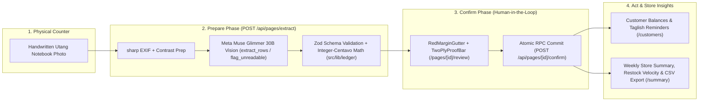

# Talaan — Notebook-to-Ledger Agent for Sari-Sari Stores

> Turns photos of handwritten *utang* (credit) notebooks into clean, checked digital ledgers using Meta's open-weights **Muse Glimmer 30B** running locally. Store owners keep their physical notebook habit and get verified records.

Built for the **Meta Global AI Developer Hackathon** (Oct 26 – Nov 4, 2026) · **Track:** Indie Developer (*Build for Your World*) · **Developer:** Dev Ejay.

---

## Architecture & How It Works



Talaan splits the agent loop into deterministic phases:

1. **Prepare Phase (`POST /api/pages/extract`):** Photo upload -> server `sharp` prep -> single vision LLM call (`extract_rows` / `flag_unreadable`) -> Zod validation (`src/lib/schemas.ts`) -> deterministic arithmetic check (`src/lib/ledger/math.ts`) -> staged in database (`needs_review`).
2. **Confirm Phase (`POST /api/pages/[id]/confirm`):** Store owner inspects `RedMarginGutter` & `TwoPlyProofBar` (`Written Total` vs. `Computed Total`), links/creates customers, and confirms -> committed atomically via Postgres RPC (`confirm_page_entries`) as verified ledger entries.
3. **Act Phase (`/customers` & `/summary`):**
   - Per-customer running balances (`sum(credit) - sum(payment)`) + on-demand Taglish payment reminder drafts (`Malumanay` or `Pormal`) with 1-tap Copy and SMS/Messenger share.
   - Weekly/30-day store summary (`/summary`), top fast-moving items for restock (*Listahan sa Pamimili*), and 1-tap UTF-8 CSV / Printable ledger export (`GET /api/ledger/export`).

*All arithmetic runs in deterministic TypeScript (`src/lib/ledger/`) using integer centavos. The LLM never computes totals.*

---

## Built During the Hackathon (Oct 26 – Nov 4, 2026)

Everything in this repository was designed, architected, and built from scratch during the hackathon window:

- **Two-Phase Bookkeeping & Integer-Centavo Discrepancy Engine (`src/lib/ledger/`):** Row multiplication checker (`quantity * unit_price !== amount`), page running-total checker (`computed_total !== written_total`), fuzzy customer name matcher (`src/lib/ledger/match.ts`), store summary & restock velocity engine (`src/lib/ledger/summary.ts`), and 1-tap UTF-8 CSV export.
- **Unified Open-Weights Vision & Tool-Calling Layer (`src/lib/model.ts`):** OpenAI-compatible client targeting **Meta Muse Glimmer 30B** (`Q4_K_M` GGUF + vision projector via `llama-server --jinja` on Kaggle 2x T4) for `extract_rows`, `flag_unreadable`, and `draft_reminder`, with explicit UI & DB model provenance tracking.
- **"The Notebook, Kept" Daylight UI (`src/app/`, `src/components/`):** High-contrast Daylight palette (`#F2F5EC` Analysis Pad Paper, `#C8302F` Red Margin Gutter, `#1E3FAE` Ballpen Blue), signature `RedMarginGutter` and sticky `TwoPlyProofBar`, audited with `impeccable detect`.
- **Supabase Multi-Tenant Postgres Schema & Atomic RPC (`supabase/migrations/`):** Row-Level Security (`stores.owner_id = (select auth.uid())`), `numeric(10,2)` currency columns, transactional `confirm_page_entries` RPC, 1-tap Demo Store auth, and scheduled demo cleanup.
- **30-Page Evaluation Harness (`scripts/eval-glimmer.ts`, `src/lib/eval/score.ts`, `eval/pages-30/`):** Deterministic centavo-exact scoring engine (`T-008`) and 30 labeled synthetic pages (15 clean, 12 planted arithmetic discrepancies, 3 unreadable blurry pages) with strict Muse Glimmer provenance watermarking.

---

## 30-Page Evaluation Benchmark (`eval/pages-30/`)

> **Grounding & Provenance Policy (`docs/grounding.md`):** Official benchmark numbers are reported exclusively from **Meta Muse Glimmer 30B** (`MODEL_PROVIDER=glimmer`). Auxiliary developer backup runs (`MODEL_PROVIDER=gemini`) are automatically watermarked `DRY RUN — AUXILIARY DEV BACKUP (NOT MUSE GLIMMER)` and excluded from official metrics below.

| Metric | Target (`docs/prd.md`) | Meta Muse Glimmer 30B (`MODEL_PROVIDER=glimmer`) | Deterministic Ledger Engine (`src/lib/ledger`) |
| --- | --- | --- | --- |
| **Customer Name Accuracy** | >= 85% | *Pending live Kaggle 2x T4 tunnel run (`TAL-03`)* | N/A |
| **Item Description Accuracy** | >= 80% | *Pending live Kaggle 2x T4 tunnel run (`TAL-03`)* | N/A |
| **Peso Amount Accuracy (Centavo-Exact)** | >= 90% | *Pending live Kaggle 2x T4 tunnel run (`TAL-03`)* | **100% (Verified by `T-003`, `T-004`)** |
| **Exact Row Match Rate** | >= 80% | *Pending live Kaggle 2x T4 tunnel run (`TAL-03`)* | N/A |
| **Discrepancy Detection Recall** | 100% | *Pending live Kaggle 2x T4 tunnel run (`TAL-03`)* | **100% on extracted rows (`T-003`, `T-008`)** |
| **Unreadable Page Detection (`flag_unreadable`)** | 100% | *Pending live Kaggle 2x T4 tunnel run (`TAL-03`)* | N/A |
| **Mean / p95 Latency (2x T4 GPU)** | <= 15,000 ms | *Pending live Kaggle 2x T4 tunnel run (`TAL-03`)* | **< 1 ms** |

Run the evaluation harness:
```bash
npm run eval:generate   # Generate 30 synthetic pages + ground truth in eval/pages-30/
npm run eval            # Run scripts/eval-glimmer.ts against active MODEL_PROVIDER
```

---

## AI Model Architecture & Policy

> **Important Note for Hackathon Judges:** **Meta Muse Glimmer 30B is the canonical, primary vision model for Talaan.** All benchmark evaluations, the Day 3 handwriting gate, and the final demonstration run strictly on Muse Glimmer 30B. The Gemini API is strictly an auxiliary developer backup used for offline frontend prototyping when away from GPU compute, and is 100% excluded from all evaluation metrics.

- **Primary & Native Engine:** **Meta Muse Glimmer 30B** (`Q4_K_M` GGUF + vision projector) served via `llama.cpp` `llama-server --jinja` on Kaggle 2x T4 GPU over an authenticated secure tunnel. Mandatory for the Day 3 Handwriting Gate, 30+ page evaluation, and final demonstration.
- **Developer Backup Only:** **Gemini API** (`MODEL_PROVIDER=gemini`) via OpenAI-compatible endpoint, used solely as an offline/backup fallback during rapid UI development when GPU instances are offline.
- **Unified Client:** Single abstraction in `src/lib/model.ts` using the `openai` SDK, with transparent model provenance badging in the UI and exact model logging on every database page record.

---

## Quick Start (Local Development)

### 1. Prerequisites
- Node.js 20+
- npm 10+
- Supabase account (Postgres + Storage + Auth)
- Kaggle notebook (2x T4 GPU) for Meta Muse Glimmer 30B (or Gemini API key as developer backup fallback)

### 2. Install & Configure
```bash
git clone <YOUR_GITHUB_REPO_URL>
cd talaan
npm install
```

Create `.env.local`:
```bash
# Supabase
NEXT_PUBLIC_SUPABASE_URL=https://<your-project>.supabase.co
NEXT_PUBLIC_SUPABASE_ANON_KEY=<your-anon-key>
SUPABASE_SERVICE_ROLE_KEY=<your-service-role-key>

# Model Provider: "glimmer" (PRIMARY - Canonical Meta Muse Glimmer 30B) | "gemini" (BACKUP - Dev test only)
MODEL_PROVIDER=glimmer

# Meta Muse Glimmer 30B (Primary / Canonical Kaggle 2x T4 tunnel endpoint)
GLIMMER_BASE_URL=https://<your-tunnel-url>/v1
GLIMMER_API_KEY=<your-tunnel-api-key>

# Gemini API (Developer Backup / Fallback only when GPU instance is inactive)
# MODEL_PROVIDER=gemini
# GEMINI_BASE_URL=https://generativelanguage.googleapis.com/v1beta/openai
# GEMINI_API_KEY=<your-gemini-key>
# GEMINI_MODEL=gemini-2.5-flash
```

### 3. Run Dev Server
```bash
npm run dev
```
Open [http://localhost:3000](http://localhost:3000).

### 4. Quality Gates & Tests
```bash
npm run lint
npx tsc --noEmit
npm test
npm run build
```

---

## Project Documentation

Complete canonical documentation lives in [`docs/`](docs/):
- [`docs/foundation.md`](docs/foundation.md) — Canonical source of truth
- [`docs/design.md`](docs/design.md) & [`docs/dsd.md`](docs/dsd.md) — Design system ("The Notebook, Kept")
- [`docs/data-model.md`](docs/data-model.md) — Postgres schema, state machines, and RLS policies
- [`docs/sprint.md`](docs/sprint.md) — Hackathon sprint backlog (`TAL-01` to `TAL-08`)
- [`docs/interviews/TEMPLATE.md`](docs/interviews/TEMPLATE.md) — Sari-sari store owner behavioral discovery guide
- [`docs/adr/`](docs/adr/) — Architecture decision records (`ADR-0001`, `ADR-0002`, `ADR-0003`)
