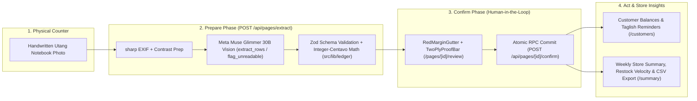

# Talaan — Notebook-to-Ledger Agent for Sari-Sari Stores

> Turns photos of handwritten *utang* (credit) notebooks into clean, checked digital ledgers using Meta's open-weights **Muse Glimmer 30B** running locally. Store owners keep their physical notebook habit and get verified records.

Built for the **Meta Global AI Developer Hackathon** (Oct 26 – Nov 4, 2026) · **Track:** Indie Developer (*Build for Your World*) · **Developer:** Dev Ejay.

---

## Architecture & How It Works



Talaan splits the agent loop into deterministic phases:

1. **Prepare Phase (`POST /api/pages/extract`):** Photo upload -> server `sharp` prep -> single vision LLM call (`extract_rows` / `flag_unreadable`) -> Zod validation (`src/lib/schemas.ts`) -> deterministic arithmetic check (`src/lib/ledger/math.ts`) -> staged in database (`needs_review`).
2. **Confirm Phase (`POST /api/pages/[id]/confirm`):** Store owner inspects `RedMarginGutter` & `TwoPlyProofBar` (`Written Total` vs. `Computed Total`), links/creates customers, and confirms -> committed atomically via Postgres RPC (`confirm_page_entries`) as verified ledger entries.
3. **Act Phase (`/customers` & `/summary`):**
   - Per-customer running balances (`sum(credit) - sum(payment)`) + on-demand Taglish payment reminder drafts (`Friendly` or `Firm`) with 1-tap Copy and SMS/Messenger share.
   - Weekly/30-day store summary (`/summary`), top fast-moving items for restock (Restock Guide), and 1-tap UTF-8 CSV / Printable ledger export (`GET /api/ledger/export`).

*All arithmetic runs in deterministic TypeScript (`src/lib/ledger/`) using integer centavos. The LLM never computes totals.*

---

## Built During the Hackathon (Oct 26 – Nov 4, 2026)

Everything in this repository was designed, architected, and built from scratch during the hackathon window:

- **Two-Phase Bookkeeping & Integer-Centavo Discrepancy Engine (`src/lib/ledger/`):** Row multiplication checker (`quantity * unit_price !== amount`), page running-total checker (`computed_total !== written_total`), fuzzy customer name matcher (`src/lib/ledger/match.ts`), store summary & restock velocity engine (`src/lib/ledger/summary.ts`), and 1-tap UTF-8 CSV export.
- **Unified Open-Weights Vision & Tool-Calling Layer (`src/lib/model.ts`):** OpenAI-compatible client targeting **Meta Muse Glimmer 30B** (`meta/muse-glimmer-30b` via NVIDIA NIM or Kaggle 2x T4 tunnel) for `extract_rows`, `flag_unreadable`, and `draft_reminder`, with exact model logging on every database page record server-side.
- **"The Notebook, Kept" Daylight UI (`src/app/`, `src/components/`):** High-contrast Daylight palette (`#F2F5EC` Analysis Pad Paper, `#C8302F` Red Margin Gutter, `#1E3FAE` Ballpen Blue), signature `RedMarginGutter` and sticky `TwoPlyProofBar`, audited with `impeccable detect`.
- **Supabase Multi-Tenant Postgres Schema & Atomic RPC (`supabase/migrations/`):** Row-Level Security (`stores.owner_id = (select auth.uid())`), `numeric(10,2)` currency columns, transactional `confirm_page_entries` RPC, 1-tap Demo Store auth, and scheduled demo cleanup.
- **30-Page Evaluation Harness (`scripts/eval-glimmer.ts`, `src/lib/eval/score.ts`, `eval/pages-30/`):** Deterministic centavo-exact scoring engine (`T-008`) and 30 labeled synthetic pages (15 clean, 12 planted arithmetic discrepancies, 3 unreadable blurry pages) with strict Muse Glimmer provenance watermarking.

---

## 30-Page Evaluation Benchmark (`eval/pages-30/`)

> **Grounding & Provenance Policy (`docs/grounding.md`):** Official benchmark numbers are reported exclusively from **Meta Muse Glimmer 30B**. Any unofficial run is automatically watermarked `DRY RUN — UNOFFICIAL RUN (NOT MUSE GLIMMER)` and excluded from official metrics below.

| Metric | Target (`docs/prd.md`) | Meta Muse Glimmer 30B | Deterministic Ledger Engine (`src/lib/ledger`) |
| --- | --- | --- | --- |
| **Customer Name Accuracy** | >= 85% | *Evaluated on Muse Glimmer (`TAL-07`)* | N/A |
| **Item Description Accuracy** | >= 80% | *Evaluated on Muse Glimmer (`TAL-07`)* | N/A |
| **Peso Amount Accuracy (Centavo-Exact)** | >= 90% | *Evaluated on Muse Glimmer (`TAL-07`)* | **100% (Verified by `T-003`, `T-004`)** |
| **Exact Row Match Rate** | >= 80% | *Evaluated on Muse Glimmer (`TAL-07`)* | N/A |
| **Discrepancy Detection Recall** | 100% | *Evaluated on Muse Glimmer (`TAL-07`)* | **100% on extracted rows (`T-003`, `T-008`)** |
| **Unreadable Page Detection (`flag_unreadable`)** | 100% | *Evaluated on Muse Glimmer (`TAL-07`)* | N/A |
| **Mean / p95 Latency** | <= 15,000 ms | *Evaluated on Muse Glimmer (`TAL-07`)* | **< 1 ms** |

Run the evaluation harness:
```bash
npm run eval:generate   # Generate 30 synthetic pages + ground truth in eval/pages-30/
npm run eval            # Run scripts/eval-glimmer.ts against Meta Muse Glimmer 30B
```

---

## AI Model Architecture & Policy

> **Important Note for Hackathon Judges:** **Meta Muse Glimmer 30B is the exclusive vision model for Talaan.** All benchmark evaluations, the Day 3 handwriting gate, and the final demonstration run strictly on open-weights Muse Glimmer 30B. Zero third-party proprietary LLM APIs are used.

- **Primary & Native Engine:** **Meta Muse Glimmer 30B** (`meta/muse-glimmer-30b`) served via NVIDIA NIM or `llama.cpp` `llama-server --jinja` on Kaggle 2x T4 GPU.
- **Unified Client:** Abstraction in `src/lib/model.ts` using the `openai` SDK, with exact model logging on every database page record server-side (`pages.model`).

---

## Quick Start (Local Development)

### 1. Prerequisites
- Node.js 20+
- npm 10+
- Supabase account (Postgres + Storage + Auth)
- Meta Muse Glimmer 30B API key (NVIDIA NIM or Kaggle 2x T4 tunnel)

### 2. Install & Configure
```bash
git clone <YOUR_GITHUB_REPO_URL>
cd talaan
npm install
```

Create `.env.local`:
```bash
# Supabase
NEXT_PUBLIC_SUPABASE_URL=https://<your-project>.supabase.co
NEXT_PUBLIC_SUPABASE_ANON_KEY=<your-anon-key>
SUPABASE_SERVICE_ROLE_KEY=<your-service-role-key>

# Meta Muse Glimmer 30B (NVIDIA NIM or Kaggle tunnel endpoint)
GLIMMER_BASE_URL=https://integrate.api.nvidia.com/v1
GLIMMER_API_KEY=<your-api-key>
GLIMMER_MODEL=meta/muse-glimmer-30b
```

### 3. Run Dev Server
```bash
npm run dev
```
Open [http://localhost:3000](http://localhost:3000).

### 4. Quality Gates & Tests
```bash
npm run lint
npx tsc --noEmit
npm test
npm run build
```

---

## Project Documentation

Complete canonical documentation lives in [`docs/`](docs/):
- [`docs/foundation.md`](docs/foundation.md) — Canonical source of truth
- [`docs/design.md`](docs/design.md) & [`docs/dsd.md`](docs/dsd.md) — Design system ("The Notebook, Kept")
- [`docs/data-model.md`](docs/data-model.md) — Postgres schema, state machines, and RLS policies
- [`docs/sprint.md`](docs/sprint.md) — Hackathon sprint backlog (`TAL-01` to `TAL-08`)
- [`docs/interviews/TEMPLATE.md`](docs/interviews/TEMPLATE.md) — Sari-sari store owner behavioral discovery guide
- [`docs/adr/`](docs/adr/) — Architecture decision records (`ADR-0001`, `ADR-0002`, `ADR-0003`)
