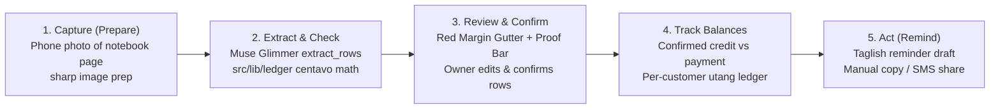

# Business Requirements Document (BRD): Talaan

**Project:** Talaan — Notebook-to-Ledger Agent for Sari-Sari Stores
**Date:** 2026-10-27
**Version:** 1.0
**Owner:** Dev Ejay
**Status:** Active
**Source of truth:** [`foundation.md`](foundation.md)
**Related:** [BPD](bpd.md) · [PRD](prd.md) · [SAD](sad.md) · [SDD](sdd.md) · [DSD](dsd.md) · [Flow](flow.md) · [Build](build.md) · [Evidence](evidence.md) · [Glossary](glossary.md)

---

> **Source-of-truth rule.** [`foundation.md`](foundation.md) is the canonical foundation document. Resolve conflicts there first, then propagate. Read `foundation.md`, then the rest of `docs/`, before reading code.
>
> **Evidence standard.** Every claim here is traceable to the project brief (`S-01`), to code (`S-10`), or to an explicit locked decision. Unsupported numbers are marked **Not validated**. Undecided items are marked **TBD**. No estimate is presented as measured. Full rules: [`grounding.md`](grounding.md).

**Status legend:** defined in [`grounding.md`](grounding.md) §3. ✅ built and verified · 🟡 partial, gated, or simulated · ⬜ planned, no code · ❌ out of scope

---

## 1. Executive Summary

### 1.1 What Talaan is

**Talaan** is a mobile-first web application and AI bookkeeping agent that turns a phone photo of a handwritten sari-sari store *utang* (credit) notebook page, supplier receipt, or typed list into a clean, arithmetic-checked digital ledger. Powered by Meta's open-weights **Muse Glimmer 30B** model paired with deterministic TypeScript arithmetic (`src/lib/ledger`), Talaan lets neighborhood store owners keep their existing paper notebook habit while gaining verified customer balances and polite Taglish payment reminder drafts.

### 1.2 Value proposition

> Talaan turns a photo of a handwritten *utang* notebook into a clean, checked ledger, using Meta's open-weights Muse Glimmer model running locally, so store owners keep their notebook habit and still get real records. (`S-01` §1)

### 1.3 What the build actually delivers

Today (`2026-10-27`), the repository contains the **Next.js 16.4.3 / React 19.3.0 / Tailwind v4 scaffold** (`S-10`). The planned hackathon build (`TAL-01` to `TAL-08`) delivers a **Two-Phase Verification Bookkeeping System**: single-turn multimodal extraction (`extract_rows` / `flag_unreadable`), deterministic centavo-exact row and page discrepancy detection (`find_discrepancies`), a human-in-the-loop Review screen (with the Red Margin Gutter and Two-Ply Proof Bar), per-customer *utang* balances, and tone-selectable Taglish reminder drafts. What it optimizes for: **arithmetic correctness, zero counter habit change, and local data privacy**.

### 1.4 Operating boundary — read before any business claim

| Boundary | Detail |
|---|---|
| Lifecycle stage | **Build** (Hackathon prototype for Meta Global AI Developer Hackathon, Oct 26 – Nov 4, 2026) |
| Data posture | **Consented / synthetic pages only** (`S-01` §4, §8). Customer names redacted in demo and repo. |
| Model posture | **Meta Muse Glimmer 30B** (`llama-server` on Kaggle 2x T4) is the canonical primary engine and mandatory for Day 3 gate, 30+ page evaluation, and final demo. **Gemini API** is strictly an auxiliary developer backup for offline UI work (`S-01` §4). |
| Pilots & Customers | ❌ Zero. No sari-sari store, cooperative, lender, or distributor has deployed, piloted, procured, or endorsed Talaan. |
| Revenue & Value Movement | ❌ Zero revenue earned. Talaan is a bookkeeping record system only and moves zero real money (`S-01` §8). |

---

## 2. Business Problem

From the project brief (`S-01` §2) and cited secondary sources (`S-02` to `S-07` in [`evidence.md`](evidence.md) §2):

| Problem | Business impact | Evidence / Status |
|---|---|---|
| **Paper-only or missing records** | Owners of ~1.1M to 1.3M+ sari-sari stores (`C-01`) often do not know their true profit, stock levels, or exact total owed per customer (`C-06`). | `S-02`, `S-06`, `S-07` |
| **Handwritten arithmetic mistakes on thin margins** | Average store markup is ~10% (`C-04`), so manual addition or multiplication errors in *utang* notebooks directly erode working capital. | `S-03` (`C-04`) |
| **Existing apps demand habit change** | One-person family operators lack time to type every item into a POS app during counter rushes; ~77% of stores remain off the largest digital platform (`C-03`). | `S-04`, `S-05` (`C-03`, `A-01`) |
| **Delayed or awkward *utang* collection** | Flipping through notebook pages to sum unpaid items and compose polite reminders takes time and causes friction with neighbors. | `S-01` §2, §5 |
| **Lack of verifiable records for credit access** | Without clean digital ledgers, stores struggle to demonstrate income for micro-loans or DTI digital accounting programs (`C-05`). | `S-02`, `S-03` (`C-05`) |

**Category distinction.** A general POS app handles digital entry but requires abandoning the paper notebook; a raw vision LLM describes an image but hallucinates arithmetic and lacks a ledger database. Talaan bridges paper capture, deterministic math verification, human confirmation, and Taglish follow-up.

---

## 3. Business Solution — The Actual Lifecycle

All steps in the diagram above are currently `⬜` Planned (`TAL-01` to `TAL-06`).

---

## 4. System Roles

Zero roles exist in code today (`src/app/page.tsx` is the default Next.js starter). Two roles are defined for the MVP build:

### 4.1 Store Owner (`store_owner`) ⬜

- **Represents:** Neighborhood sari-sari store operator (`S-01` §2).
- **Screens:** Upload / Capture (`/`), Review & Discrepancy (`/pages/[id]/review`), Customer Balances (`/customers`), Customer Detail & Taglish Reminder Modal (`/customers/[id]`).
- **Capabilities:** Upload notebook photos, review/edit staged rows, resolve row/page discrepancies, match or create customers, confirm pages into the ledger, view customer balances, and generate/copy/share Taglish reminder drafts.
- **Gate:** Explicit human confirmation (`POST /api/pages/[id]/confirm`) required before any staged row updates customer balances.
- **Security:** Authenticated via Supabase Auth (`Email/Password` or `1-Tap Demo Store Login`); isolated via Postgres RLS (`stores.owner_id = auth.uid()`).

### 4.2 Anonymous Visitor (`anon`) ⬜

- **Represents:** Unauthenticated user or hackathon judge arriving at `/login`.
- **Screens:** Login & 1-Tap Demo Store Entry (`/login`).
- **Capabilities:** Sign in with credentials or launch the pre-seeded Demo Store session in one tap.
- **Security:** Zero read/write access to `stores`, `customers`, `pages`, `entries`, or `reminders` tables until authenticated.

### 4.3 Cooperative / Barangay Hub Operator ⬜ (Roadmap)

Described in `S-01` §3 and §6 as a prospective host of a shared local Muse Glimmer GPU box. No multi-tenant hub admin role exists in v1 scope.

---

## 5. Stakeholders

Every entity below is a **prospective** stakeholder ([`evidence.md`](evidence.md) §6). No agreement, integration, endorsement, or procurement exists.

| Category | Prospective entities | Interest |
|---|---|---|
| **Primary End Users** | Philippine sari-sari store owners (~1.1M–1.3M+ stores; `C-01`) | Accurate *utang* tracking, error detection, and faster debt collection without changing counter habits |
| **Community Hosts** | Cooperatives, barangay associations, LGUs | Shared local hosting of open-weights Muse Glimmer to support local micro-retailers privately |
| **Financial & Supply Chain Targets** | Micro-lenders, fintechs, FMCG distributors | Owner-consented verified store cash-flow summaries and restock order aggregation |
| **Hackathon Evaluators** | Meta Global AI Developer Hackathon judges | Impact (30%), Use of Meta AI tooling / Muse Glimmer (25%), Demo (25%), Technical depth & evaluation (20%) (`S-01` §10) |

---

## 6. Business Requirements with Status

Each requirement traces to [`prd.md`](prd.md) §4 (`US-NN`), [`sprint.md`](sprint.md) (`TAL-NN`), and [`test-plan.md`](test-plan.md) §3 (`T-NNN`). All requirements are currently `⬜` Planned.

### BR-01 Notebook Photo Capture & Image Pre-processing ⬜
The system must accept phone photos of handwritten notebook pages, supplier receipts, or typed lists, pre-process them server-side (`sharp` resize, rotate, contrast), and store them in a private Supabase Storage bucket scoped to the store owner.
**Traces:** US-01 · TAL-01, TAL-02 · tests T-001

### BR-02 Multimodal Structured Extraction & Unreadable Recovery ⬜
The system must extract structured candidate rows (`customer`, `item`, optional `quantity` and `unit_price`, `amount`, `entry_type`: `'credit' | 'payment' | 'cash_sale'`, `confidence`) and `written_total` using `src/lib/model.ts` (Meta Muse Glimmer 30B canonical primary; Gemini auxiliary developer backup only), or trigger a specific retake request (`flag_unreadable`) when a page cannot be read. Every extraction must log the active `model` and `latency_ms`.
**Traces:** US-02, US-07 · TAL-02, TAL-03 · tests T-002, T-008

### BR-03 Deterministic Two-Level Discrepancy Verification ⬜
The system must deterministically recompute row-level arithmetic (`quantity * unit_price === amount`) and page-level arithmetic (`computed_total === written_total`) in TypeScript (`src/lib/ledger`) using integer centavos, flagging any discrepancy or low-confidence row (`confidence < 0.80`) as `needs_review = true`.
**Traces:** US-03 · TAL-04 · tests T-003, T-004

### BR-04 Human-in-the-Loop Review, Customer Matching & Ledger Commit ⬜
The system must present staged rows on a Review screen highlighting `needs_review` items and comparing `Written Total` vs. `Computed Total`, allow the owner to edit values and match/create customer records, and commit entries to customer balances only after explicit owner confirmation (`confirmed_by_user = true`).
**Traces:** US-04 · TAL-05 · tests T-005

### BR-05 Per-Customer Utang & Bayad Balance Tracking ⬜
The system must maintain per-customer running balances computed from confirmed entries (`sum(credit) - sum(payment)`) along with last activity date and itemized transaction history, isolated per store via Postgres RLS.
**Traces:** US-05 · TAL-06 · tests T-006

### BR-06 Tone-Selectable Taglish Payment Reminder Drafts ⬜
The system must generate polite Taglish payment reminder drafts (`Malumanay / Friendly` or `Pormal / Firm`) citing a customer's confirmed unpaid items and total balance, providing 1-tap Copy and native Web Share / `sms:` handoff without ever sending messages automatically.
**Traces:** US-06 · TAL-06 · tests T-007

### BR-07 Muse Glimmer Evaluation & Provenance Transparency ⬜
The system must display the active model in the UI, pass the Day 3 Handwriting Gate on 10 pages (≥80% row accuracy on Muse Glimmer; `A-05`), and evaluate field-level accuracy, row-level accuracy, total-match rate, discrepancy detection rate, and latency across 30+ labeled pages on Muse Glimmer only.
**Traces:** US-02, US-03 · TAL-03, TAL-07 · tests T-008

### BR-08 Stretch Capabilities (Restock, Weekly Summary, Multi-Page, Export) ⬜
Only after `BR-01` through `BR-07` are verified, support supplier receipt restock lists, weekly summaries, multi-page month views, shelf photo experiments, or CSV/print exports (`S-01` §5).
**Traces:** US-08 · Backlog · tests TBD

### Out of scope ❌
Voice/audio input; payment processing or e-wallet integration; POS hardware; tax/BIR filing; automatic message transmission; credit scoring or financial advice; native mobile apps; multi-user store staff roles; medical, legal, political, or job-screening features (`S-01` §8).

---

## 7. Technology Stack

Canonical: [`sad.md`](sad.md) §2. Pinned versions and planned packages: [`evidence.md`](evidence.md) §5.

---

## 8. Business Model

Canonical: [`bpd.md`](bpd.md) §4. **Known:** Zero fees are charged in the hackathon build; open-weights Muse Glimmer eliminates marginal per-token inference costs when self-hosted. **Undecided:** All commercial pricing and B2B partner structures (`A-02` to `A-04`; see [`bpd.md`](bpd.md) §4.2).

---

## 9. Competitive Position

Canonical comparison: [`foundation.md`](foundation.md) §11.

**Where differentiation sits:** Talaan is designed around **zero counter habit change** (the physical notebook remains the primary input) combined with **deterministic code verification of handwritten arithmetic** and **local open-weights inference** (Meta Muse Glimmer 30B).

---

## 10. Compliance and Risk

### 10.1 Compliance posture — intent, not attestation

| Area | Intent | Reality |
|---|---|---|
| **Data Privacy (Customer Names & Debts)** | Keep customer debt records private via local open-weights inference, Supabase RLS, private storage bucket, and redacted/synthetic demo data (`S-01` §3, §4, §8). | **Design control only.** No Philippine NPC (Data Privacy Act of 2012) legal review has been performed. |
| **Financial / Accounting Accuracy** | Prevent AI math hallucinations via deterministic centavo math (`src/lib/ledger`) and mandatory human confirmation before saving. | **Bookkeeping aid only.** Not a BIR-accredited POS or certified accounting system (`S-01` §8). |
| **Messaging & Telecommunications** | Draft Taglish reminders only; owner manually copies or shares via their own device. | **No automated SMS transmission.** Avoids unsolicited commercial messaging compliance scope. |

### 10.2 Risk register

From `S-01` §8:

| Risk | Impact | Mitigation status |
|---|---|---|
| **Muse Glimmer handwriting accuracy on Filipino/Taglish is unknown (`A-05`)** | High | ⬜ **Day 3 Gate (`TAL-03`):** Test 10 real pages on Glimmer. If row accuracy < 80%, narrow to printed receipts/typed lists or pivot. |
| **Kaggle 2x T4 inference speed is slow** | High | ⬜ Use `sharp` image crop/resize, low reasoning level, 32K context, single-turn extraction (`Two-Phase Split`), and clear progress UI (`TAL-02`, `TAL-03`). |
| **Kaggle sessions are temporary & tunnel URL changes per session (`A-06`)** | High | ⬜ Script Kaggle setup, cache `llama-server` + GGUF in a private Kaggle Dataset, keep `GLIMMER_BASE_URL` in env vars, and record the demo early (`TAL-03`, `TAL-08`). |
| **Prompts tuned on Gemini may break on Muse Glimmer** | Medium | ⬜ Switch completely to Glimmer by Oct 31 (`S-01` §11) and run all gate/eval tests strictly on Glimmer (`TAL-03`, `TAL-07`). |
| **Serverless function timeouts vs. slow T4 inference** | Medium | ⬜ Keep model calls single-turn and run `next dev` locally against the Kaggle tunnel for the demo recording (`S-01` §4, §8). |
| **Model errors affect real money records** | High | ⬜ Deterministic arithmetic in `src/lib/ledger`, confidence flags (`< 0.80`), and mandatory human confirmation gate (`TAL-04`, `TAL-05`). |
| **Privacy exposure of real neighborhood debts** | High | ✅ Policy locked: use only consented/redacted or synthetic pages in repo, evals, and demo (`S-01` §4, §8). |

---

## 11. Success Metrics

Per `S-01` §8 and §9, metrics are defined for the **Muse Glimmer Evaluation Harness** (`TAL-03`, `TAL-07`). No baseline has been measured yet:

| Candidate metric | Baseline | Target | Status |
|---|---|---|---|
| Day 3 Gate Row-Level Accuracy (10 real pages on Glimmer) | Not measured | **≥ 80%** (`A-05`) | ⬜ (`TAL-03`) |
| 30+ Page Eval: Field-Level Accuracy (`customer`, `item`, `amount`, `entry_type`) | Not measured | Report actual measured % | ⬜ (`TAL-07`) |
| 30+ Page Eval: Row-Level Accuracy | Not measured | Report actual measured % | ⬜ (`TAL-07`) |
| 30+ Page Eval: Total-Match Rate (`computed_total === written_total` post-review) | Not measured | Report actual measured % | ⬜ (`TAL-07`) |
| 30+ Page Eval: Discrepancy Detection Rate (planted errors found vs. false alarms) | Not measured | **100% deterministic math** on extracted numbers | ⬜ (`TAL-07`) |
| 30+ Page Eval: Inference Latency (`latency_ms` / seconds per page on 2x T4) | Not measured | Report actual measured seconds | ⬜ (`TAL-07`) |
| Store Owner Discovery Interviews Completed | 0 | **3 to 5 owners** (`S-01` §10, §11) | ⬜ (Oct 29 – Nov 1) |

---

## 12. Goal Alignment

Canonical text: [`foundation.md`](foundation.md) §12.

---

## 13. Open Business Decisions

| # | Decision | Owner | Blocks |
|---:|---|---|---|
| 1 | Day 3 Handwriting Gate outcome (keep handwritten notebook focus vs. narrow to printed receipts/lists) | Dev Ejay | Final demo scope (`TAL-03`) |
| 2 | Official Hackathon Rules confirmation on Gemini dev testing & $150 partner credits | Dev Ejay | Dev workflow compliance (`S-01` §11) |
| 3 | Post-hackathon commercial model selection (Owner Freemium vs. Cooperative Hub vs. Lender/Distributor B2B) | Dev Ejay | Any post-hackathon pilot (`foundation.md` `Q8`) |
| 4 | Data Privacy Act (NPC) & legal review | Counsel (not engaged) | Any real-customer deployment outside hackathon demo |

Full question set: [`foundation.md` §14](foundation.md).

---

## Self-Check

- [x] Every requirement (`BR-01` to `BR-08`) carries an honest as-built status (`⬜`) with traces
- [x] Secondary statistics are linked to [`evidence.md`](evidence.md) claims (`C-01` to `C-08`) and assumptions (`A-01` to `A-06`)
- [x] Named entities described as prospective targets, not partners
- [x] Compliance stated as design intent with legal reviews named as outstanding
- [x] Evaluation metrics marked `Not measured` until `TAL-03` and `TAL-07` run
