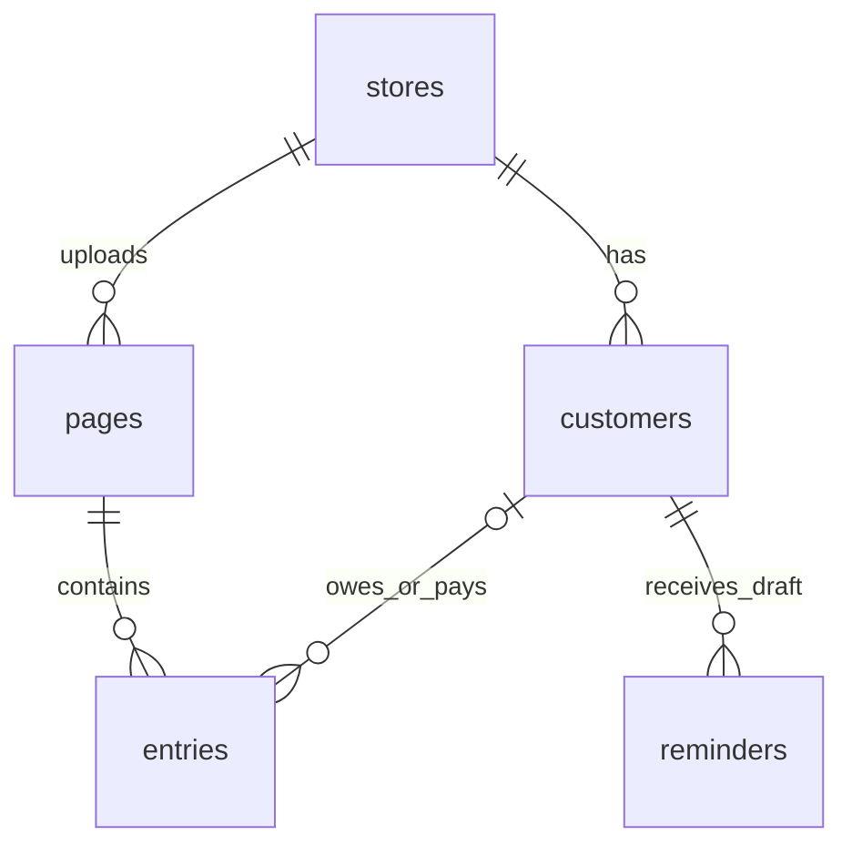
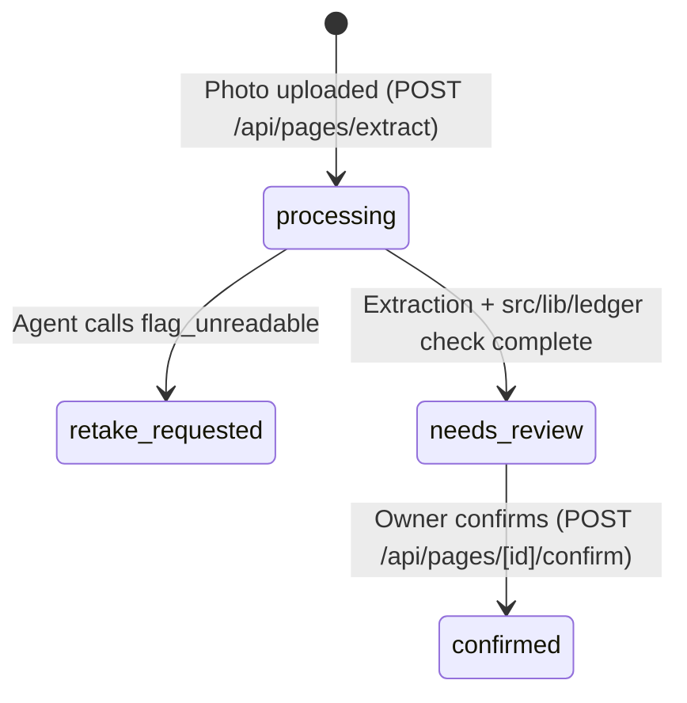

# Data Model: Talaan

**Project:** Talaan — Notebook-to-Ledger Agent for Sari-Sari Stores
**Date:** 2026-10-27
**Version:** 1.0
**Owner:** Dev Ejay
**Status:** Active
**Source of truth:** [`foundation.md`](foundation.md)
**Related:** [SDD](sdd.md) · [Glossary](glossary.md) · [Security](security.md) · [API](api.md) · [Build](build.md) · [Grounding](grounding.md)

---

> **As-built and planned rule.** As of `2026-10-27`, **zero SQL migrations exist in the repository** (`supabase/migrations/` is `⬜` Planned in `TAL-01`). The schema below is the canonical target specification derived from `S-01` §4 and locked `/grill-me` decisions (`Q2`, `Q3`, `Q8`), authored in compliance with `supabase-postgres-best-practices` (`schema-`, `security-`, `query-`). Once `TAL-01` creates `supabase/migrations/`, the migration files become the as-built authority.

---

## 1. Conventions (`supabase-postgres-best-practices`)

| Topic | Rule |
|---|---|
| Naming | `snake_case` plural table names (`stores`, `customers`, `pages`, `entries`, `reminders`); `snake_case` column names |
| Primary keys | `uuid` generated via `gen_random_uuid()` |
| Foreign key indexes | Every foreign key column (`owner_id`, `store_id`, `page_id`, `customer_id`) has an explicit B-tree index (`query-missing-indexes`) |
| Timestamps | `timestamptz` (`created_at not null default now()`, `updated_at not null default now()`) |
| Deletion & Audit | Confirmed `pages` and `entries` preserve notebook audit evidence (`written_total`, `computed_total`, `image_path`); unconfirmed staging entries (`confirmed_by_user = false`) can be edited or replaced during review before confirmation |
| Tenancy | Row-Level Security (RLS) enabled on all 5 tables; scoped to the authenticated owner via `stores.owner_id = (select auth.uid())` (`security-rls`) |
| Numeric values | All monetary columns (`written_total`, `computed_total`, `unit_price`, `amount`) use `numeric(10,2)`—**never** `real` or `double precision`. Confidence scores use `numeric(3,2)`. |

---

## 2. Entity Overview

Target entity count: **5 tables** (`stores`, `customers`, `pages`, `entries`, `reminders`) + **1 private Storage bucket** (`notebook-pages`). Current count in repo migrations: **0** (`⬜` Planned in `TAL-01`).

| Group | Entities |
|---|---|
| Identity and tenancy | `stores` (linked to `auth.users` via `owner_id`) |
| Core ledger domain | `customers`, `pages`, `entries` |
| Action / communication | `reminders` |
| Object storage | Supabase Storage private bucket `notebook-pages` |

---

## 3. Entity Catalog

### 3.1 `stores` (⬜ Planned — `TAL-01`)

Purpose: Represents a single sari-sari store owned by an authenticated user. Deletion: Cascade on test reset only. Migration: `supabase/migrations/0001_initial_schema.sql` (`⬜`).

| Field | Type | Null | Default | Constraint | PII | Description |
|---|---|:---:|---|---|:---:|---|
| `id` | `uuid` | No | `gen_random_uuid()` | PK | No | Store identifier |
| `owner_id` | `uuid` | No | — | FK → `auth.users(id)`, Indexed | No | Authenticated store owner |
| `name` | `text` | No | — | `CHECK (char_length(trim(name)) > 0)` | Yes | Store name (e.g., `"Aling Nena's Sari-Sari Store"`) |
| `created_at` | `timestamptz` | No | `now()` | — | No | Creation timestamp |

### 3.2 `customers` (⬜ Planned — `TAL-01`)

Purpose: Represents a neighborhood customer who buys on credit (*utang*) or makes debt payments (*bayad*).

| Field | Type | Null | Default | Constraint | PII | Description |
|---|---|:---:|---|---|:---:|---|
| `id` | `uuid` | No | `gen_random_uuid()` | PK | No | Customer identifier |
| `store_id` | `uuid` | No | — | FK → `stores(id) ON DELETE CASCADE`, Indexed | No | Owning store |
| `name` | `text` | No | — | `UNIQUE (store_id, normalized_name)` | Yes | Customer display name (redacted/synthetic in demo) |
| `normalized_name` | `text` | No | — | Generated or lowercase trimmed | Yes | Lowercase trimmed name for auto-matching |
| `phone_optional` | `text` | Yes | `null` | — | Yes | Optional contact number for `sms:` deep-link |
| `created_at` | `timestamptz` | No | `now()` | — | No | Creation timestamp |

### 3.3 `pages` (⬜ Planned — `TAL-01`)

Purpose: Represents an uploaded notebook page, supplier receipt, or typed list and its page-level reconciliation metadata.

| Field | Type | Null | Default | Constraint | PII | Description |
|---|---|:---:|---|---|:---:|---|
| `id` | `uuid` | No | `gen_random_uuid()` | PK | No | Page identifier |
| `store_id` | `uuid` | No | — | FK → `stores(id) ON DELETE CASCADE`, Indexed | No | Owning store |
| `image_path` | `text` | No | — | — | Yes | Path in private `notebook-pages` bucket |
| `page_date` | `date` | Yes | `current_date` | — | No | Date written on the notebook page |
| `written_total` | `numeric(10,2)` | Yes | `null` | `CHECK (written_total >= 0)` | No | Total written by owner on the physical page (if any) |
| `computed_total` | `numeric(10,2)` | No | `0.00` | `CHECK (computed_total >= 0)` | No | Exact total computed deterministically by `src/lib/ledger` |
| `has_page_discrepancy` | `boolean` | No | `false` | — | No | `true` when `written_total IS NOT NULL AND computed_total <> written_total` |
| `status` | `text` | No | `'processing'` | `CHECK (status IN ('processing', 'needs_review', 'retake_requested', 'confirmed'))` | No | Lifecycle state ([`glossary.md`](glossary.md) §3) |
| `retake_reason` | `text` | Yes | `null` | — | No | Populated when `flag_unreadable` sets `status = 'retake_requested'` |
| `model` | `text` | No | `'muse-glimmer'` | — | No | Model identifier logged for provenance and eval filtering (`S-01` §4) |
| `latency_ms` | `integer` | Yes | `null` | `CHECK (latency_ms >= 0)` | No | End-to-end model extraction latency in milliseconds |
| `created_at` | `timestamptz` | No | `now()` | — | No | Upload timestamp |
| `confirmed_at` | `timestamptz` | Yes | `null` | — | No | Timestamp when owner confirmed the page |

### 3.4 `entries` (⬜ Planned — `TAL-01`)

Purpose: Represents a single extracted row on a `Page` (`credit`, `payment`, or `cash_sale`).

| Field | Type | Null | Default | Constraint | PII | Description |
|---|---|:---:|---|---|:---:|---|
| `id` | `uuid` | No | `gen_random_uuid()` | PK | No | Entry identifier |
| `page_id` | `uuid` | No | — | FK → `pages(id) ON DELETE CASCADE`, Indexed | No | Parent notebook page |
| `store_id` | `uuid` | No | — | FK → `stores(id) ON DELETE CASCADE`, Indexed | No | Denormalized store FK for fast RLS & balance queries |
| `customer_id` | `uuid` | Yes | `null` | FK → `customers(id) ON DELETE SET NULL`, Indexed | No | Linked customer record (required before confirming `credit` or `payment` rows) |
| `extracted_customer_name` | `text` | Yes | `null` | — | Yes | Raw customer name read from handwriting (e.g., `"Ate Nena"`) |
| `item` | `text` | No | — | `CHECK (char_length(trim(item)) > 0)` | No | Item description or `"Bayad"` |
| `quantity` | `numeric(10,2)` | Yes | `null` | `CHECK (quantity > 0)` | No | Optional item quantity (e.g., `3`) |
| `unit_price` | `numeric(10,2)` | Yes | `null` | `CHECK (unit_price >= 0)` | No | Optional unit price in Pesos (e.g., `12.00`) |
| `amount` | `numeric(10,2)` | No | — | `CHECK (amount >= 0)` | No | Line total in Pesos (e.g., `36.00`) |
| `entry_type` | `text` | No | `'credit'` | `CHECK (entry_type IN ('credit', 'payment', 'cash_sale'))` | No | `'credit'` (*utang*), `'payment'` (*bayad*), or `'cash_sale'` |
| `line_discrepancy` | `boolean` | No | `false` | — | No | `true` when `quantity * unit_price <> amount` |
| `confidence` | `numeric(3,2)` | No | `1.00` | `CHECK (confidence >= 0 AND confidence <= 1)` | No | Vision extraction confidence (`0.00`–`1.00`) |
| `needs_review` | `boolean` | No | `false` | — | No | `true` when `confidence < 0.80` or `line_discrepancy = true` |
| `confirmed_by_user` | `boolean` | No | `false` | — | No | `false` in Prepare phase; `true` only after human Confirm (`POST /api/pages/[id]/confirm`) |
| `created_at` | `timestamptz` | No | `now()` | — | No | Creation timestamp |

### 3.5 `reminders` (⬜ Planned — `TAL-01`)

Purpose: Stores drafted Taglish payment reminders generated for a customer.

| Field | Type | Null | Default | Constraint | PII | Description |
|---|---|:---:|---|---|:---:|---|
| `id` | `uuid` | No | `gen_random_uuid()` | PK | No | Reminder identifier |
| `store_id` | `uuid` | No | — | FK → `stores(id) ON DELETE CASCADE`, Indexed | No | Owning store |
| `customer_id` | `uuid` | No | — | FK → `customers(id) ON DELETE CASCADE`, Indexed | No | Target customer |
| `tone` | `text` | No | `'friendly'` | `CHECK (tone IN ('friendly', 'firm'))` | No | `'friendly'` (*Malumanay*) or `'firm'` (*Pormal*) |
| `message` | `text` | No | — | — | Yes | Drafted Taglish message text |
| `model` | `text` | No | `'muse-glimmer'` | — | No | Model that drafted the reminder |
| `created_at` | `timestamptz` | No | `now()` | — | No | Creation timestamp |

---

## 4. States and Transitions

State names match [`glossary.md`](glossary.md) §3.

| Entity | From | To | Allowed when | Enforced at |
|---|---|---|---|---|
| `pages.status` | `'processing'` | `'retake_requested'` | `flag_unreadable` tool called by model | `POST /api/pages/extract` |
| `pages.status` | `'processing'` | `'needs_review'` | Zod validation + `src/lib/ledger` check succeed | `POST /api/pages/extract` |
| `pages.status` | `'needs_review'` | `'confirmed'` | Owner submits reviewed rows (`confirmed_by_user = true`) and all `credit`/`payment` rows have a `customer_id` | `POST /api/pages/[id]/confirm` + `confirm_page` Postgres RPC (`ADR-0003`) |

---

## 5. Constraints and Invariants

| Invariant | Enforced at | Test |
|---|---|---|
| Unconfirmed entries (`confirmed_by_user = false`) never affect customer balances | `src/lib/ledger/math.ts` + SQL query filter `WHERE confirmed_by_user = true` | `T-005`, `T-006` ([`test-plan.md`](test-plan.md)) |
| A page with `status = 'confirmed'` cannot be confirmed a second time | `POST /api/pages/[id]/confirm` idempotency guard + DB check | `T-005` |
| Every `'credit'` or `'payment'` entry on a confirmed page must have a non-null `customer_id` | `POST /api/pages/[id]/confirm` + DB `CHECK` constraint (`NOT confirmed_by_user OR entry_type = 'cash_sale' OR customer_id IS NOT NULL`) | `T-005` |
| All money amounts are non-negative `numeric(10,2)` values | Postgres `CHECK (amount >= 0)` + Zod schema + `src/lib/ledger/math.ts` | `T-003` |

---

## 6. Access Control per Entity

Policy source: `supabase/migrations/0001_initial_schema.sql` (`⬜` Planned in `TAL-01`). Using `(select auth.uid())` per `supabase-postgres-best-practices` (`security-rls` / `query-rls-initplan`) so Postgres caches the `auth.uid()` evaluation per query:

| Entity | Read | Write | Mechanism |
|---|---|---|---|
| `stores` | `store_owner` (`owner_id = (select auth.uid())`) | `store_owner` (`owner_id = (select auth.uid())`) | Postgres RLS |
| `customers` | `store_owner` (`store_id IN (SELECT id FROM stores WHERE owner_id = (select auth.uid()))`) | Same | Postgres RLS |
| `pages` | Same | Same | Postgres RLS |
| `entries` | Same | Same | Postgres RLS |
| `reminders` | Same | Same | Postgres RLS |
| `storage.objects` (`notebook-pages`) | `store_owner` (folder prefix `{store_id}/*`) | Same | Supabase Storage RLS + Signed URLs |

---

## 7. Classification and Retention

| Entity | PII | Retention | Disposal | Legal basis |
|---|:---:|---|---|---|
| `stores` | Yes (store name) | Hackathon duration / **TBD** for production | Delete store row (cascades) | Consented demo/test data (`S-01` §4, §8) |
| `customers` | Yes (redacted/synthetic customer names in demo) | **TBD** | Cascade on store delete | Consented/synthetic demo data |
| `pages` + Storage images | Yes (handwritten names on notebook photo) | **TBD** | Delete storage object + `pages` row | Private bucket; consented/synthetic pages only (`S-01` §4, §8) |
| `entries` | Yes (`extracted_customer_name`) | **TBD** | Cascade on page delete | Consented/synthetic demo data |
| `reminders` | Yes (customer name in message) | **TBD** | Cascade on customer delete | Consented/synthetic demo data |

---

## 8. Migrations

| Topic | Rule |
|---|---|
| Location and naming | `supabase/migrations/NNNN_description.sql` (`⬜` Planned in `TAL-01`) |
| Direction | Forward-only SQL migrations |
| Who runs them | Developer via Supabase CLI (`npx supabase db push` / SQL Editor) |
| Edited after merge? | Never. Add a new migration file |

---

## 9. Derived Data

| Projection / query | Source | Computation | Used by |
|---|---|---|---|
| **Customer Balance Summary** | `entries` (`WHERE confirmed_by_user = true`) | `SUM(CASE WHEN entry_type = 'credit' THEN amount WHEN entry_type = 'payment' THEN -amount ELSE 0 END)` | `GET /api/customers`, `/customers`, `/customers/[id]` |

---

## 10. Open Data Decisions

| # | Decision | Blocks | Reference |
|---|---|---|---|
| 1 | Post-hackathon data retention window for raw notebook images | Production privacy policy | `foundation.md` `Q8` / **TBD** |

---

## Self-Check

- [x] Current migration count (0) and target entity count (5) stated honestly
- [x] Every PII field is marked
- [x] Every enum value (`pages.status`, `entries.entry_type`, `reminders.tone`) matches [`glossary.md`](glossary.md) §3
- [x] All monetary columns use `numeric(10,2)` and all FKs are indexed per `supabase-postgres-best-practices`
