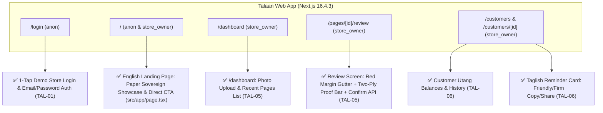
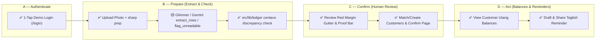
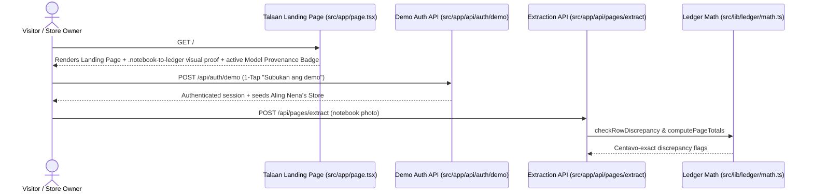
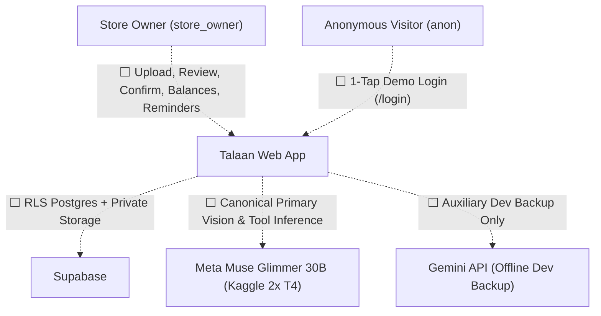

# Talaan — App Flow and Feature Scope

**Project:** Talaan — Notebook-to-Ledger Agent for Sari-Sari Stores
**Date:** 2026-10-27
**Version:** 1.0
**Owner:** Dev Ejay
**Status:** Active
**Source of truth:** [`foundation.md`](foundation.md)
**Related:** [BRD](brd.md) · [BPD](bpd.md) · [PRD](prd.md) · [SAD](sad.md) · [SDD](sdd.md) · [DSD](dsd.md) · [Build](build.md) · [Test plan](test-plan.md)

---

> **Source-of-truth rule.** [`foundation.md`](foundation.md) is canonical. Resolve conflicts there first, then propagate.
>
> **Purpose.** The honest status map: what is wired today (`2026-10-27`), what is environment-switched, and what is planned in [`sprint.md`](sprint.md). Status marks are defined in [`grounding.md`](grounding.md) §3. A ✅ requires a named test or command.

**Operating boundary:** Hackathon Build Stage — Consented/redacted or synthetic notebook data only; zero real customer accounts; zero value movement.

---

## 1. Surfaces — What Lives Where



---

## 2. Product Journey



---

## 3. Demonstrable Path Today (`2026-10-27`)

Today, the Talaan Landing Page (`/`), 1-Tap Demo Store Auth (`/login` & `POST /api/auth/demo`), Image Prep + Extraction API (`POST /api/pages/extract`), and Deterministic Centavo Ledger Math (`src/lib/ledger`) are wired and test-verified.



Setup and validation commands: [`build.md`](build.md).

---

## 4. Feature Scope Matrix

Kept in lockstep with [`prd.md`](prd.md) §3:

| Capability | Priority | Status | Where (path or table) | Verified by |
|---|---|---|---|---|
| Next.js 16.4.3 App Shell & Landing Page (`/`) | Must | ✅ | `src/app/layout.tsx`, `src/app/page.tsx`, `src/components/landing/` | `npm run lint`, `npx tsc --noEmit`, `npm test` (`T-004`) |
| 1. 1-Tap Demo Store Login & Supabase Auth + RLS | Must | ✅ | `src/app/login/page.tsx`, `supabase/migrations/0001_initial_schema.sql` (`TAL-01`) | `npm run lint`, `npx tsc --noEmit` (`T-001`) |
| 2. Photo Upload & `sharp` Image Prep | Must | ✅ | `src/app/api/pages/extract/route.ts`, `src/lib/image.ts` (`TAL-02`) | `npm run lint`, `npx tsc --noEmit` |
| 3. Structured Extraction (`credit`/`payment`/`cash_sale`, confidence, model badge) | Must | 🟡 partial | `src/lib/model.ts`, `src/lib/schemas.ts`, `src/app/api/pages/extract/route.ts` (`TAL-02`, `TAL-03`) | `npm run lint`, `npx tsc --noEmit` (Glimmer gate in `TAL-03`) |
| 4. Unreadable Page Retake Request (`flag_unreadable`) | Must | ✅ | `src/app/api/pages/extract/route.ts`, `src/lib/schemas.ts` (`TAL-02`) | `npm run lint`, `npx tsc --noEmit` |
| 5. Two-Level Deterministic Discrepancy Finder | Must | ✅ | `src/lib/ledger/math.ts` (`TAL-04`) | `npm test` (`T-003`, `T-004`) |
| 6. Review Screen (Red Margin Gutter, Two-Ply Proof Bar, Confirm API) | Must | ✅ | `src/app/pages/[id]/review/page.tsx`, `src/app/api/pages/[id]/confirm/route.ts` (`TAL-05`) | `npm test` (`T-005`), `npx tsc --noEmit` |
| 6b. Upload Dashboard & Pill Scan Button (`/dashboard`) | Must | ✅ | `src/app/dashboard/page.tsx`, `src/components/dashboard/` (`TAL-05`) | `npm run lint`, `npx tsc --noEmit` |
| 6c. Daily Demo Data & Storage Cleanup (`/api/cron/cleanup-demo`) | Should | ✅ | `src/app/api/cron/cleanup-demo/route.ts`, `vercel.json` | `npm test` |
| 7. Customer Balances Ledger (`sum(credit) - sum(payment)`) | Must | ✅ | `src/services/customers.ts`, `src/app/customers/`, `src/app/api/customers/` (`TAL-06`) | `npm test` (`T-006`) |
| 8. Taglish Reminder Drafts (Tone Selector + Copy & Web Share / `sms:`) | Must | ✅ | `src/app/customers/[id]/page.tsx`, `src/components/customers/ReminderCard.tsx`, `src/app/api/reminders/draft/route.ts` (`TAL-06`) | `npm test` (`T-007`) |
| 9. 30+ Page Muse Glimmer Evaluation Harness | Must | 🟡 partial | `scripts/eval-glimmer.ts`, `src/lib/eval/score.ts`, `eval/pages-30/` (`TAL-07`) | `npm test` (`T-008`) — live Glimmer run pending `TAL-03` tunnel |
| 10–12. Weekly Store Summary, Restock Velocity & 1-Tap CSV/Print Export (`US-08`) | Could | ✅ | `src/lib/ledger/summary.ts`, `src/app/summary/page.tsx`, `src/app/api/ledger/export/route.ts` | `npm test` (`summary.test.ts`, `export/route.test.ts`) |
| 13. Shelf Photo Stock Count (Experimental) | Could | ⬜ roadmap | Deferred (`US-08`) | — |
| 14–17. Voice input, Auto-SMS sending, Payments/POS, Credit scoring, Native app | Won't | ❌ out of scope | Excluded by `S-01` §3, §8 | — |

---

## 5. Gated, Simulated, and Environment-Switched Behavior

| Behavior | Mark | What exists | What does not | Switch / Gate | Rules |
|---|---|---|---|---|---|
| **Dual Model Provider (`glimmer` primary vs. `gemini` backup)** | ✅ | `src/lib/model.ts` switching via `MODEL_PROVIDER` | Live Kaggle tunnel endpoint (`TAL-03`) | `MODEL_PROVIDER` env var (`glimmer` canonical primary \| `gemini` auxiliary dev backup) | Gemini is strictly an offline backup in `.env.local` while prototyping. Day 3 gate, 30+ page evaluation, and final demo must run on `glimmer`. |

---

## 6. Roadmap — Status View

Canonical roadmap is [`prd.md`](prd.md) §9.

```mermaid
flowchart LR
  subgraph now ["Built Today (2026-10-27)"]
    N1["✅ Next.js 16.4.3 / Tailwind v4 Scaffold"]
    N2["✅ Full Documentation & Grounding Suite"]
  end
  subgraph s1 ["Sprint 1 (Oct 27–28)"]
    P1["✅ TAL-01: Supabase Schema, RLS & 1-Tap Auth"]
    P2["✅ TAL-02: lib/model.ts, sharp & Extract API"]
    P3["⬜ TAL-03: Kaggle Glimmer Tunnel & Day 3 Gate (10 pages)"]
  end
  subgraph s2 ["Sprint 2 (Oct 29–Nov 1)"]
    P4["✅ TAL-04: lib/ledger Two-Level Discrepancy Math"]
    P5["⬜ TAL-05: Review UI (Red Margin + Proof Bar) & Confirm API"]
    P6["⬜ TAL-06: Customer Balances & Taglish Reminders"]
  end
  subgraph s3 ["Sprint 3 (Nov 2–Nov 4)"]
    P7["⬜ TAL-07: 30+ Page Muse Glimmer Evaluation"]
    P8["⬜ TAL-08: README, Polish & Demo Video"]
  end
  now --> s1 --> s2 --> s3
```



---

## 7. Actor View



---

## 8. Verification Commands

Status claims in this repository are checkable via:

```bash
npm run lint
npx tsc --noEmit
npm test          # Vitest (to be added in TAL-04)
```

Requirement-to-test mapping: [`test-plan.md`](test-plan.md) §3.

---

*Update this file in the same change that alters feature status.*
