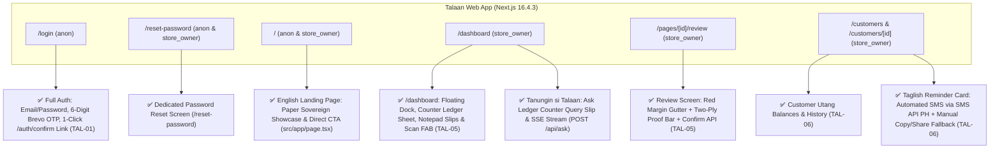
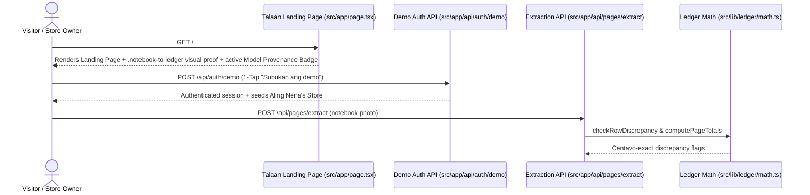
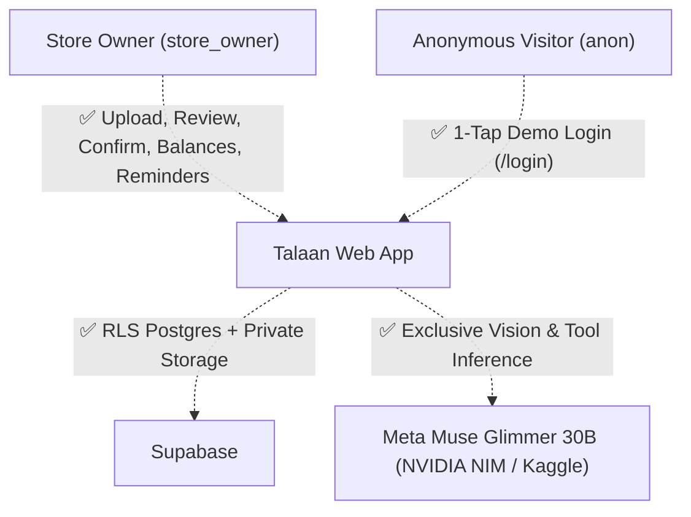

# Talaan — App Flow and Feature Scope

**Project:** Talaan — Notebook-to-Ledger Agent for Sari-Sari Stores
**Date:** 2026-10-27
**Version:** 1.0
**Owner:** Dev Ejay
**Status:** Active
**Source of truth:** [`foundation.md`](foundation.md)
**Related:** [BRD](brd.md) · [BPD](bpd.md) · [PRD](prd.md) · [SAD](sad.md) · [SDD](sdd.md) · [DSD](dsd.md) · [Build](build.md) · [Test plan](test-plan.md)

---

> **Source-of-truth rule.** [`foundation.md`](foundation.md) is canonical. Resolve conflicts there first, then propagate.
>
> **Purpose.** The honest status map: what is wired today (`2026-10-27`), what is environment-switched, and what is planned in [`sprint.md`](sprint.md). Status marks are defined in [`grounding.md`](grounding.md) §3. A ✅ requires a named test or command.

**Operating boundary:** Hackathon Build Stage — Consented/redacted or synthetic notebook data only; zero real customer accounts; zero value movement.

---

## 1. Surfaces — What Lives Where



---

## 2. Product Journey

```mermaid
flowchart LR
  subgraph A ["A — Authenticate"]
    A1["✅ Full Auth: Email/Password + 6-Digit Brevo OTP (/login)"]
  end
  subgraph B ["B — Prepare (Extract & Check)"]
    B1["✅ Upload Photo + sharp prep"]
    B2["✅ Meta Muse Glimmer 30B extract_rows / flag_unreadable"]
    B3["✅ src/lib/ledger centavo discrepancy check"]
  end
  subgraph C ["C — Confirm (Human Review)"]
    C1["✅ Review Red Margin Gutter & Proof Bar"]
    C2["✅ Match/Create Customers & Confirm Page"]
  end
  subgraph D ["D — Act (Balances, Reminders & Ask Agent)"]
    D1["✅ View Customer Utang Balances"]
    D2["✅ Automated SMS Reminders via SMS API PH"]
    D3["✅ Tanungin si Talaan (Conversational Ledger Agent)"]
  end
  A1 --> B1 --> B2 --> B3 --> C1 --> C2 --> D1 --> D2 --> D3
```



---

## 3. Demonstrable Path Today (`2026-10-27`)

Today, the Talaan Landing Page (`/`), 1-Tap Demo Store Auth (`/login` & `POST /api/auth/demo`), Image Prep + Extraction API (`POST /api/pages/extract`), and Deterministic Centavo Ledger Math (`src/lib/ledger`) are wired and test-verified.



Setup and validation commands: [`build.md`](build.md).

---

## 4. Feature Scope Matrix

Kept in lockstep with [`prd.md`](prd.md) §3:

| Capability | Priority | Status | Where (path or table) | Verified by |
|---|---|---|---|---|
| Next.js 16.4.3 App Shell & Landing Page (`/`) | Must | ✅ | `src/app/layout.tsx`, `src/app/page.tsx`, `src/components/landing/` | `npm run lint`, `npx tsc --noEmit`, `npm test` (`T-004`) |
| 1. Full Auth: Brevo SMTP OTP & 1-Click Confirmation (`/auth/confirm`), Password Reset (`/reset-password`) | Must | ✅ | `src/app/login/page.tsx`, `src/app/auth/confirm/route.ts`, `src/app/reset-password/page.tsx`, `templates/email/` (`TAL-01`) | `npm test` (`auth/confirm/__tests__/route.test.ts`), `npx tsc --noEmit`, `npm run lint` |
| 2. Photo Upload & `sharp` Image Prep | Must | ✅ | `src/app/api/pages/extract/route.ts`, `src/lib/image.ts` (`TAL-02`) | `npm run lint`, `npx tsc --noEmit` |
| 3. Structured Extraction (`credit`/`payment`/`cash_sale`, confidence, model badge) | Must | 🟡 partial | `src/lib/model.ts`, `src/lib/schemas.ts`, `src/app/api/pages/extract/route.ts` (`TAL-02`, `TAL-03`) | `npm run lint`, `npx tsc --noEmit` (Glimmer gate in `TAL-03`) |
| 4. Unreadable Page Retake Request (`flag_unreadable`) | Must | ✅ | `src/app/api/pages/extract/route.ts`, `src/lib/schemas.ts` (`TAL-02`) | `npm run lint`, `npx tsc --noEmit` |
| 5. Two-Level Deterministic Discrepancy Finder | Must | ✅ | `src/lib/ledger/math.ts` (`TAL-04`) | `npm test` (`T-003`, `T-004`) |
| 6. Review Screen (Red Margin Gutter, Two-Ply Proof Bar, Confirm API) | Must | ✅ | `src/app/pages/[id]/review/page.tsx`, `src/app/api/pages/[id]/confirm/route.ts` (`TAL-05`) | `npm test` (`T-005`), `npx tsc --noEmit` |
| 6b. Upload Dashboard & Scan FAB with Camera Option (`/dashboard`) | Must | ✅ | `src/app/dashboard/page.tsx`, `src/components/dashboard/ScanButton.tsx` (`TAL-05`) | `npm run lint`, `npx tsc --noEmit`, `npm test` |
| 6c. Responsive Ledger & Spreadsheet Page Review | Must | ✅ | `src/app/pages/[id]/review/`, `src/components/review/` | `npm test` (`T-005`), `npx tsc --noEmit` |
| 6c. Daily Demo Data & Storage Cleanup (`/api/cron/cleanup-demo`) | Should | ✅ | `src/app/api/cron/cleanup-demo/route.ts`, `vercel.json` | `npm test` |
| 7. Customer Balances Ledger (`sum(credit) - sum(payment)`) | Must | ✅ | `src/services/customers.ts`, `src/app/customers/`, `src/app/api/customers/` (`TAL-06`) | `npm test` (`T-006`) |
| 8. Automated SMS via SMS API PH & Taglish Reminder Drafts | Must | ✅ | `src/lib/sms.ts`, `src/app/api/reminders/send-sms/`, `src/components/customers/CustomerPhoneModal.tsx`, `src/components/customers/ReminderCard.tsx` (`TAL-06`) | `npm test` (`sms.test.ts`, `send-sms/route.test.ts`) |
| 9. 30+ Page Muse Glimmer Evaluation Harness | Must | 🟡 partial | `scripts/eval-glimmer.ts`, `src/lib/eval/score.ts`, `eval/pages-30/` (`TAL-07`) | `npm test` (`T-008`) — live Glimmer run pending `TAL-03` tunnel |
| 10–12. Weekly Store Summary, Restock Velocity & 1-Tap CSV/Print Export (`US-08`) | Could | ✅ | `src/lib/ledger/summary.ts`, `src/app/summary/page.tsx`, `src/app/api/ledger/export/route.ts` | `npm test` (`summary.test.ts`, `export/route.test.ts`) |
| 13. Customer E-Resibo Itemized Statement Slip & Text Export (`US-09`, `TAL-09`) | Could | ✅ | `src/components/customers/CustomerReceiptModal.tsx`, `src/components/customers/CustomerBalanceCard.tsx`, `src/lib/ledger/formatters.ts` | `npm test` (`formatters.test.ts`) |
| 14. Pamalengke Restock Checklist for Wholesale Trips (`US-10`, `TAL-09`) | Could | ✅ | `src/components/summary/PamalengkeChecklistModal.tsx`, `src/lib/ledger/formatters.ts` | `npm test` (`formatters.test.ts`) |
| 15. Direct Counter Payment Recording (`US-11`, `TAL-10`) | Must | ✅ | `src/app/api/customers/[id]/payments/route.ts`, `src/components/customers/RecordPaymentModal.tsx` | `npm test` (`payments/route.test.ts`) |
| 16. Store Liquidity Health Indicator (`US-12`, `TAL-10`) | Should | ✅ | `src/lib/ledger/liquidity.ts`, `src/components/dashboard/LiquidityHealthCard.tsx` | `npm test` (`liquidity.test.ts`) |
| 17. Credit Limit Alert & 24h Duplicate Payment Review Warning (`US-13`, `TAL-10`) | Should | ✅ | `src/lib/ledger/math.ts`, `src/components/review/ExcelReviewRow.tsx`, `src/components/review/RedMarginGutter.tsx` | `npm test` (`math.test.ts`) |
| 18. Semi-Offline Fast-Scan Queue (`US-14`, `TAL-10`) | Should | ✅ | `src/lib/offline-db.ts`, `src/hooks/useOfflineScanQueue.ts`, `src/components/dashboard/OfflineQueueBanner.tsx` | `npm test` (`offline-db.test.ts`) |
| 18b. Paper Motion & Animation Stack (Lenis, GSAP, Motion, FormKit, Impeccable) | Must | ✅ | `src/components/providers/SmoothScrollProvider.tsx`, `src/components/landing/GsapPaperChoreography.tsx`, `motion/react`, `@formkit/auto-animate` | `npm run lint`, `npx tsc --noEmit`, `npm run build` |
| 19. Shelf Photo Stock Count (Experimental) | Could | ⬜ roadmap | Deferred (`US-08`) | — |
| 20–23. Voice input, Auto-SMS sending, External payment rails, Credit scoring, Native app | Won't | ❌ out of scope | Excluded by `S-01` §3, §8 | — |

---

## 5. Gated, Simulated, and Environment-Switched Behavior

| Behavior | Mark | What exists | What does not | Switch / Gate | Rules |
|---|---|---|---|---|---|
| **Pure Model Provider (`meta/muse-glimmer-30b`)** | ✅ | `src/lib/model.ts` pointing exclusively to Meta Muse Glimmer 30B via NVIDIA NIM / Kaggle | None (live verified) | `GLIMMER_BASE_URL` and `GLIMMER_API_KEY` env vars | Pure open-weights execution. Gemini completely retired (`ADR-0003`). Fails closed with `"The Model is currently unavailable, please try again later."` if endpoint unavailable. |

---

## 6. Roadmap — Status View

Canonical roadmap is [`prd.md`](prd.md) §9.

```mermaid
flowchart LR
  subgraph now ["Built Today (2026-10-27)"]
    N1["✅ Next.js 16.4.3 / Tailwind v4 Scaffold"]
    N2["✅ Full Documentation & Grounding Suite"]
  end
  subgraph s1 ["Sprint 1 (Oct 27–28)"]
    P1["✅ TAL-01: Supabase Schema, RLS & 1-Tap Auth"]
    P2["✅ TAL-02: lib/model.ts, sharp & Extract API"]
    P3["✅ TAL-03: Live Meta Muse Glimmer 30B & Handwriting Pipeline"]
  end
  subgraph s2 ["Sprint 2 (Oct 29–Nov 1)"]
    P4["✅ TAL-04: lib/ledger Two-Level Discrepancy Math"]
    P5["✅ TAL-05: Review UI (Red Margin + Proof Bar) & Confirm API"]
    P6["✅ TAL-06: Customer Balances & Taglish Reminders"]
  end
  subgraph s3 ["Sprint 3 (Nov 2–Nov 4)"]
    P7["⬜ TAL-07: 30+ Page Muse Glimmer Evaluation"]
    P8["✅ TAL-08: README, Polish & Demo Video"]
  end
  now --> s1 --> s2 --> s3
```



---

## 7. Actor View



---

## 8. Verification Commands

Status claims in this repository are checkable via:

```bash
npm run lint
npx tsc --noEmit
npm test          # Vitest (to be added in TAL-04)
```

Requirement-to-test mapping: [`test-plan.md`](test-plan.md) §3.

---

*Update this file in the same change that alters feature status.*
