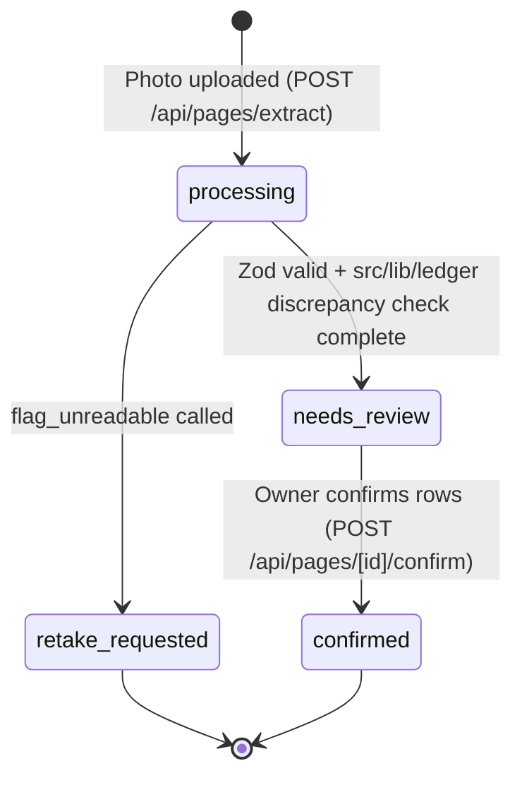

# Module: Payments and Ledger (Bookkeeping & Utang Ledger)

**Activated in** [`foundation.md`](../foundation.md) §0 (Active Modules). Talaan maintains a store bookkeeping and customer credit (*utang* / *bayad*) ledger where model errors or floating-point drift would corrupt real money records (`S-01` §3, §8).

> **Scope adaptation note:** Talaan does **not** process payments, connect to e-wallets, or sign blockchain transactions (`S-01` §8). External payment gateways, cryptographic key custody, and external chain reconcilers are **Not Applicable (`N/A`)**. All ledger invariants below govern Talaan's **Two-Phase Notebook-to-Ledger Bookkeeping Engine**.

**Source of truth:** [`foundation.md`](../foundation.md) · **Grounding:** [`grounding.md`](../grounding.md)

Where a rule is not yet implemented in code, it is marked ⬜ (`TAL-01`, `TAL-04`, `TAL-05`), never ✅.

---

## 1. Ledger Invariants

1. **Two-phase on every ledger-mutating path (`Prepare` -> `Confirm`).**
   - **Phase 1 (`Prepare` — `POST /api/pages/extract`):** Validates the image, extracts candidate rows via `src/lib/model.ts`, validates against Zod (`src/lib/schemas.ts`), runs deterministic discrepancy math in `src/lib/ledger/`, and writes staged rows (`confirmed_by_user = false`, `pages.status = 'needs_review'`). Staged rows **never** count toward customer balances.
   - **Phase 2 (`Confirm` — `POST /api/pages/[id]/confirm`):** Accepts human-reviewed rows and matched `customer_id`s, re-verifies deterministic math in `src/lib/ledger/`, and atomically transitions the page to `pages.status = 'confirmed'` with `entries.confirmed_by_user = true`.
2. **Idempotency on confirmation.** Confirming a `page_id` that is already `confirmed` is a no-op or rejected (`409 CONFLICT`) so a double-tap or network retry never duplicates customer *utang* or *bayad* entries.
3. **Zero LLM arithmetic & fail-closed numerics.**
   - Never ask the LLM to compute a sum, difference, product, or customer balance.
   - All arithmetic in `src/lib/ledger/` converts Peso amounts to **exact integer centavos** (`Math.round(amount * 100)`) before adding, subtracting, or multiplying, and rejects `NaN`, `Infinity`, negative amounts, or values exceeding `₱99,999,999.99` (`numeric(10,2)`).
   - Database columns storing money (`pages.written_total`, `pages.computed_total`, `entries.unit_price`, `entries.amount`) use Postgres `numeric(10,2)`, never `real` or `double precision`.
4. **Immutable audit trail of confirmed pages.** Once `pages.status = 'confirmed'`, the original notebook photo (`image_path`) and the notebook's `written_total` are preserved alongside `computed_total`. Adjustments after confirmation are recorded as new entries or audited corrections rather than silently overwriting the original notebook evidence.
5. **Database enforces tenant and state integrity.** Row-Level Security (`stores.owner_id = auth.uid()`), `NOT NULL` constraints, `CHECK (amount >= 0)`, and valid enum states (`pages.status`, `entries.entry_type`) live in Postgres migrations (`supabase/migrations/`), not only in client code.
6. **Environment boundary.** Hackathon demo and evaluation runs use only synthetic or consented/redacted notebook pages (`S-01` §4, §8).
7. **No secret in client-bundled variables** (`NEXT_PUBLIC_*`), source, logs, or docs.

---

## 2. Reference Sequence (Two-Phase Bookkeeping Split)

```mermaid
sequenceDiagram
  actor U as Store Owner (Phone Browser)
  participant P as Prepare Route (POST /api/pages/extract)
  participant M as Vision Model (Glimmer / Gemini)
  participant L as Deterministic Ledger (src/lib/ledger)
  participant D as Supabase (Postgres + Storage)
  participant C as Confirm Route (POST /api/pages/[id]/confirm)

  U->>P: Upload notebook photo
  P->>D: Store image in private bucket (sharp pre-processed)
  P->>M: Single vision call (extract_rows / flag_unreadable)
  M-->>P: Structured JSON candidate rows + written_total
  P->>L: Zod validate + compute centavo row & page discrepancies
  P->>D: Insert staged page (status = 'needs_review') + unconfirmed entries
  P-->>U: Staged rows + discrepancy flags + customer auto-matches
  U->>U: Review Red Margin Gutter & Two-Ply Proof Bar; edit/confirm
  U->>C: Submit confirmed rows + matched customer_ids
  C->>L: Re-verify centavo math & check page idempotency
  C->>D: Transaction: update entries (confirmed_by_user = true) & page (status = 'confirmed')
  C-->>U: Updated Customer Balances
```

Buys: zero LLM math errors, mandatory human-in-the-loop verification, idempotency against double-submits, and fast single-turn vision calls on 2x T4 GPUs.

---

## 3. Implementing the Ledger Module (`TAL-04`, `TAL-05`)

1. **`src/lib/ledger/math.ts` (⬜ Planned):**
   - `toCentavos(pesos: number): number` and `toPesos(centavos: number): number`.
   - `checkRowDiscrepancy(row)`: returns `true` when `quantity` and `unit_price` are present and `Math.round(quantity * toCentavos(unit_price)) !== toCentavos(amount)`.
   - `computePageTotals(rows, writtenTotal)`: computes exact `computed_total` in centavos and flags `has_page_discrepancy` when `written_total !== null && toCentavos(computed_total) !== toCentavos(written_total)`.
   - `computeCustomerBalance(entries)`: computes `sum(credit) - sum(payment)` for confirmed entries only (`confirmed_by_user === true`).
2. **`src/app/api/pages/extract/route.ts` (⬜ Planned):** Prepare phase endpoint.
3. **`src/app/api/pages/[id]/confirm/route.ts` (⬜ Planned):** Confirm phase endpoint with idempotency check (`pages.status !== 'confirmed'`).
4. **Unit & Property Tests (`src/lib/ledger/__tests__/math.test.ts` — ⬜ Planned):** Vitest coverage for floating-point edge cases (e.g., `0.1 + 0.2`, `3 * 12.10`), planted addition errors, and `credit` / `payment` / `cash_sale` balance rules ([`test-plan.md`](../test-plan.md)).

---

## 4. Page & Entry Reconciliation States



---

## 5. Where This Module Adds Content to the Core Docs

| Doc | Added Content |
|---|---|
| [`sad.md`](../sad.md) §3 | The §2 Two-Phase Prepare/Confirm sequence and deterministic `src/lib/ledger` boundary |
| [`sdd.md`](../sdd.md) §1.2 | `src/lib/ledger/` subsystem and Prepare/Confirm route handlers |
| [`data-model.md`](../data-model.md) §3–§5 | `numeric(10,2)` columns, `pages.status` and `entries.entry_type` enums, idempotency invariants |
| [`dsd.md`](../dsd.md) §4 | Red Margin Gutter, Two-Ply Proof Bar, and double-submit protection on confirmation |
| [`security.md`](../security.md) §4 | Mitigation of LLM arithmetic hallucination (`T-02`) and unauthorized ledger mutation |
| [`test-plan.md`](../test-plan.md) §1, §3 | Unit and invariant tests (`T-002`, `T-003`) for centavo math and discrepancy detection |

---

## Self-Check

- [x] Every ledger-mutating flow separates `Prepare` (`/api/pages/extract`) from human `Confirm` (`/api/pages/[id]/confirm`)
- [x] Zero LLM arithmetic; all math specified in integer centavos / `numeric(10,2)`
- [x] External payment rails and server-side key signing explicitly marked out of scope (`N/A`)
- [x] Unbuilt code paths marked ⬜ Planned
