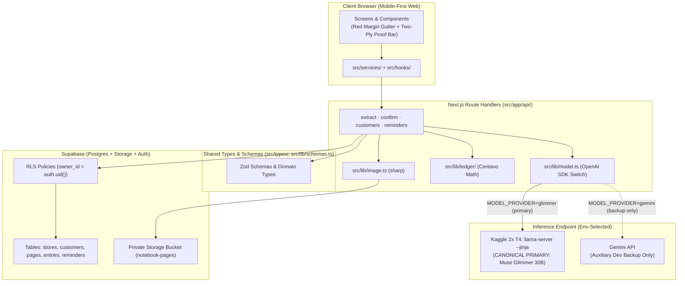

# Software Architecture Document (SAD): Talaan

**Project:** Talaan — Notebook-to-Ledger Agent for Sari-Sari Stores
**Date:** 2026-10-27
**Version:** 1.0
**Owner:** Dev Ejay
**Status:** Active
**Source of truth:** [`foundation.md`](foundation.md)
**Related:** [BRD](brd.md) · [BPD](bpd.md) · [PRD](prd.md) · [SDD](sdd.md) · [DSD](dsd.md) · [Flow](flow.md) · [Build](build.md) · [Security](security.md) · [Ops](ops.md) · [Grounding](grounding.md) · [Evidence](evidence.md) · [Glossary](glossary.md)

---

> **Source-of-truth rule.** [`foundation.md`](foundation.md) is the canonical foundation document. Resolve conflicts there first, then propagate.
>
> **As-built and planned clarity.** Today (`2026-10-27`), the repository contains the Next.js 16.4.3 / React 19.3.0 / Tailwind v4 scaffold (`package.json`). The 4-tier architecture below defines the target structure for `TAL-01` through `TAL-08`, with every unbuilt module explicitly marked `⬜` Planned. Evidence rules: [`grounding.md`](grounding.md).

---

## 1. Architectural Overview

### 1.1 Pattern

**Talaan** is a **Two-Phase Verification Web Application & Multimodal Agent** built on a unified **Next.js App Router** codebase with four tiers:

1. **Mobile-First Web Client (`src/app/`, `src/components/`)** — React 19 + Tailwind CSS v4 interface ("The Notebook, Kept" with Red Margin Gutter per [`docs/design.md`](design.md)) for capturing notebook photos, reviewing staged rows, inspecting customer balances, and copying/sharing Taglish reminders.
2. **Server Route Handlers & Deterministic Ledger Engine (`src/app/api/`, `src/lib/ledger/`, `src/lib/image.ts`, `src/lib/schemas.ts`)** — Next.js server endpoints that pre-process images with `sharp`, validate model responses with Zod, and execute centavo-exact row and page arithmetic checks in TypeScript.
3. **Data & Storage Tier (Supabase Postgres + Private Storage + Auth/RLS)** — Persistent tenant-isolated storage for `stores`, `customers`, `pages`, `entries`, and `reminders` (`numeric(10,2)` money columns) plus private storage for notebook photos.
4. **Multimodal Inference Tier (`src/lib/model.ts` → Meta Muse Glimmer 30B Primary / Auxiliary Dev Gemini)** — OpenAI-compatible client pointing natively at **Meta Muse Glimmer 30B** (`llama-server --jinja` on Kaggle 2x T4 GPU via authenticated tunnel) as the canonical primary engine, with **Gemini API** strictly as an auxiliary developer backup in local `.env.local` for offline development.

### 1.2 The load-bearing architectural decision

**Trust for financial accuracy and data isolation is placed in deterministic server code (`src/lib/ledger`), explicit human confirmation (`POST /api/pages/[id]/confirm`), and Postgres Row-Level Security (RLS)—never in the LLM or the browser client.**

- **Zero LLM arithmetic:** Muse Glimmer reads handwriting into candidate JSON fields, but never calculates sums, products, discrepancies, or customer balances. All math happens in `src/lib/ledger/math.ts` using integer centavos (`ADR-0001`).
- **Two-Phase Split (`Prepare` vs. `Confirm`):** Uploading a photo (`POST /api/pages/extract`) writes only unconfirmed staging rows (`confirmed_by_user = false`, `pages.status = 'needs_review'`). Unconfirmed rows cannot alter customer balances until the store owner submits `POST /api/pages/[id]/confirm`.
- **Database-enforced tenant isolation:** Every table is scoped to `store_id`, and Supabase RLS policies enforce `stores.owner_id = auth.uid()`.

### 1.3 Structural breakdown

| App shell & routes | `src/app/` | Mobile-first screens (`/login`, `/`, `/pages/[id]/review`, `/customers`, `/customers/[id]`) | 🟡 App shell, `/` Landing Page, `/login` built; review and customer screens planned (`TAL-05`, `TAL-06`) |
| UI components | `src/components/` | Modular sub-components (`Amount`, `NotebookLedgerProof`, `DemoCtaBar`, `RedMarginGutter`, `TwoPlyProofBar`) | 🟡 Shared & Landing components built; Review UI planned (`TAL-05`) |
| Client services & hooks | `src/services/`, `src/hooks/` | Typed API callers and state hooks for upload, review, balances, and reminders | ⬜ Planned (`TAL-05`, `TAL-06`) |
| Shared domain types & Zod schemas | `src/types/`, `src/lib/schemas.ts` | Canonical TypeScript interfaces and Zod runtime validators (`PageExtractionSchema`, etc.) | ✅ Built (`TAL-02`) |
| Deterministic ledger engine | `src/lib/ledger/` | Integer-centavo row check (`qty * unit_price === amount`), page check (`computed_total === written_total`), and customer balance math | ✅ Built & Tested (`TAL-04`) |
| Unified AI client & prompts | `src/lib/model.ts`, `src/lib/prompts/` | Single `openai` SDK switch between `glimmer` (canonical default) and `gemini` (auxiliary dev backup only) + tool schemas | ✅ Built (`TAL-02`) |
| Image pre-processor | `src/lib/image.ts` | Server-side `sharp` resize, auto-orientation, contrast enhancement, and cropping | ✅ Built (`TAL-02`) |
| API Route Handlers | `src/app/api/` | `POST /api/pages/extract`, `POST /api/auth/demo`, `POST /api/pages/[id]/confirm`, `GET /api/customers`, `POST /api/reminders/draft` | 🟡 Demo Auth & Extract API built; confirm, customer & reminder routes planned |
| Database migrations & RLS | `supabase/migrations/` | DDL for `stores`, `customers`, `pages`, `entries`, `reminders`, indexes, and RLS policies | ✅ Built (`TAL-01`) |
| Evaluation & Kaggle scripts | `scripts/`, `eval/` | Kaggle `llama-server` setup script and 30+ page Muse Glimmer evaluation harness | ⬜ Planned (`TAL-03`, `TAL-07`) |

---

## 2. Technology Stack

Pinned versions come from `package.json` (`S-10`); planned packages are tracked in [`evidence.md`](evidence.md) §5.

| Layer | Technology | Version | Rationale / trade-off |
|---|---|---|---|
| Framework & Routing | **Next.js (App Router)** | `16.4.3` (✅ Installed) | Single TypeScript codebase for mobile-first UI and backend Route Handlers (`S-01` §4) |
| UI Runtime | **React / React DOM** | `19.3.0` (✅ Installed) | Server and Client Components with fast transitions |
| Styling | **Tailwind CSS** | `^4` (✅ Installed) | CSS-first token authority in `src/app/globals.css` |
| Language | **TypeScript** | `^5` (✅ Installed) | Strict end-to-end type safety |
| Database, Auth & Storage | **Supabase (`@supabase/supabase-js`)** | `^2.118.0` (✅ Installed) | Managed Postgres (`numeric(10,2)`), Auth + RLS tenant isolation, and private Storage bucket with signed URLs |
| Primary Vision & Tool LLM | **Meta Muse Glimmer 30B** (`Q4_K_M` GGUF ~16.8 GB + ~1.4 GB projector) | Served via `llama.cpp` `llama-server` (`--jinja`, CUDA arch 75) on Kaggle 2x T4 (`⬜`) | Canonical primary engine: open weights (Apache 2.0), multimodal vision + tool calling, zero token fees (`C-07`) |
| Auxiliary Dev Backup LLM | **Gemini API** (OpenAI-compatible endpoint) | Supported in `src/lib/model.ts` (`MODEL_PROVIDER=gemini`) | Auxiliary developer backup fallback for offline UI development; strictly excluded from Day 3 gate, evals, and final demo (`S-01` §4) |
| Model SDK | **`openai` npm package** | ⬜ Planned (`TAL-02`) | Identical code path in `src/lib/model.ts` for both `llama-server` and Gemini |
| Validation | **Zod** | ⬜ Planned (`TAL-02`) | Rejects malformed LLM JSON before any ledger or DB logic runs |
| Image Processing | **`sharp`** | ⬜ Planned (`TAL-02`) | Shrinks image token count and boosts handwriting contrast before calling 2x T4 GPU |
| Test Runner | **Vitest** | ⬜ Planned (`TAL-04`) | Fast TypeScript unit, contract, and evaluation harness execution |

---

## 3. Component Communication

### 3.1 Runtime topology

### 3.2 Key interaction sequence (Two-Phase Prepare & Confirm)

See [`modules/payments-ledger.md`](modules/payments-ledger.md) §2 for the full sequence diagram:
1. **Phase 1 (`POST /api/pages/extract`):** Authenticates `store_owner` → runs `sharp` prep → uploads image to private bucket → calls `src/lib/model.ts` (`extract_rows` or `flag_unreadable`) → validates with Zod → runs `src/lib/ledger` (`find_discrepancies`) → saves staged `pages` (`needs_review`) and unconfirmed `entries` (`confirmed_by_user = false`).
2. **Phase 2 (`POST /api/pages/[id]/confirm`):** Authenticates `store_owner` → verifies page is not already confirmed → re-computes centavo math in `src/lib/ledger` → resolves `customer_id` links → updates `entries.confirmed_by_user = true` and `pages.status = 'confirmed'` in Postgres.

### 3.3 Authorization boundaries

| Boundary | Mechanism |
|---|---|
| Client → Next.js Route Handlers | Supabase Auth session cookie / JWT verified server-side on every `/api/*` route |
| Next.js Route Handlers → Supabase Postgres | Authenticated Supabase server client enforcing RLS (`stores.owner_id = auth.uid()`) |
| Next.js Route Handlers → Supabase Storage | Private bucket (`notebook-pages`); images accessed only via short-lived signed URLs |
| Next.js Server → Kaggle `llama-server` Tunnel | Server-only `GLIMMER_BASE_URL` + `Bearer ${GLIMMER_API_KEY}` (`llama-server --api-key`); never exposed to client |

### 3.4 External integrations

| Integration | Posture |
|---|---|
| **Meta Muse Glimmer 30B (`llama-server` on Kaggle 2x T4)** | ⬜ Planned (`TAL-02`, `TAL-03`) — Primary model for gate, evaluation, and demo |
| **Gemini API (OpenAI-compatible endpoint)** | ⬜ Planned (`TAL-02`) — Local development testing only (`MODEL_PROVIDER=gemini`) |
| **Supabase (Postgres, Auth, Private Storage)** | ⬜ Planned (`TAL-01`) — Core persistence and auth layer |

---

## 4. Quality Attributes

### 4.1 Service-level objectives

**No production SLO is defined.** Inference latency on Kaggle 2x T4 GPUs will be measured empirically during `TAL-03` and `TAL-07` and recorded in [`evidence.md`](evidence.md) §3.

| Attribute | Target | Status |
|---|---|---|
| Day 3 Handwriting Gate Row Accuracy (10 pages on Glimmer) | **≥ 80%** (`A-05`) | ⬜ Pending measurement (`TAL-03`) |
| 2x T4 Page Extraction Latency (`latency_ms`) | Measure & report across reasoning levels | ⬜ Pending measurement (`TAL-07`) |
| Deterministic Discrepancy Math Accuracy (`src/lib/ledger`) | **100%** on extracted numeric inputs | ⬜ Pending unit tests (`TAL-04`) |

### 4.2 Correctness and integrity — the strongest attribute

- **Integer centavo arithmetic (`src/lib/ledger`):** Eliminates IEEE-754 floating-point drift (`0.1 + 0.2`) and LLM addition hallucinations.
- **Two-level discrepancy verification:** Checks both row multiplication (`quantity * unit_price === amount`) and page summation (`computed_total === written_total`).
- **Fail-closed Zod validation:** Rejects any model response missing required fields or containing out-of-range numbers.
- **Human confirmation gate:** Unconfirmed rows (`confirmed_by_user = false`) are strictly excluded from customer balance queries.

### 4.3 Security

Canonical: [`security.md`](security.md). Load-bearing controls: Supabase Auth + Postgres RLS by `store_id`/`owner_id`, private Storage bucket with signed URLs, server-only model API keys (`GLIMMER_API_KEY`, `GEMINI_API_KEY`), and strict Two-Phase Split preventing prompt-injected autonomous DB writes.

### 4.4 Privacy

- Only synthetic or consented/redacted notebook pages are used in the repository, evaluation dataset, and demo (`S-01` §4, §8).
- Open-weights Muse Glimmer allows self-hosted/local execution so customer names and debts do not go to third-party commercial clouds.

### 4.5 Scalability & Operability

- **Present:** Scaffolded Next.js 16.4.3 app.
- **Hackathon runtime constraint:** Kaggle GPU sessions are temporary and quota-limited; for the demo recording, running `next dev` locally against the Kaggle tunnel avoids serverless function execution timeouts (`S-01` §4, §8).

---

## 5. Architectural Constraints and Debt

| Constraint | Why it exists | Consequence / Mitigation |
|---|---|---|
| **Kaggle 2x T4 inference latency** | 30B vision model on dual T4 GPUs is slower than commercial cloud APIs | Pre-crop/resize images with `sharp`, use low reasoning setting, 32K context, single-turn calls (`Two-Phase Split`), and clear progress UI (`S-01` §8) |
| **Temporary Kaggle sessions & changing tunnel URLs (`A-06`)** | Kaggle notebooks expire after session limits and generate a new tunnel URL per session | Cache built `llama-server` and GGUF in a private Kaggle Dataset; keep `GLIMMER_BASE_URL` in `.env.local`; record demo video early (`S-01` §4, §8) |
| **Serverless function timeout limits on Vercel** | Hosted serverless routes may time out waiting for T4 responses | Run `next dev` locally against the Kaggle tunnel for evaluation and demo recording (`S-01` §4, §8) |
| **Prompt/tool-call formatting differences (`gemini` vs. `glimmer`)** | Dev iteration uses Gemini while gate/eval/demo use Muse Glimmer | Switch to Glimmer by Oct 31 and re-verify all tool schemas (`--jinja`) on Glimmer (`S-01` §4, §11) |

---

## 6. Roadmap Impact on Architecture

| Roadmap item | Architectural work required |
|---|---|
| **Sprint 1 (`TAL-01`–`TAL-03`)** ⬜ | Add `@supabase/supabase-js`, `openai`, `zod`, `sharp`; create `supabase/migrations/`; build `src/lib/model.ts`, `src/lib/image.ts`, and `POST /api/pages/extract`; provision Kaggle `llama-server` tunnel |
| **Sprint 2 (`TAL-04`–`TAL-06`)** ⬜ | Add `vitest`; build `src/lib/ledger/`; build Review UI (`RedMarginGutter`, `TwoPlyProofBar`), `POST /api/pages/[id]/confirm`, Customer Balances, and `POST /api/reminders/draft` |
| **Sprint 3 (`TAL-07`–`TAL-08`)** ⬜ | Build `scripts/eval-glimmer.ts` runner over `eval/pages-30/` and record metrics |
| **Stretch: Multi-page Month View (`S3`)** ⬜ | Increase `llama-server` context flag from 32K to 131K and add multi-page batch aggregation |

---

## 7. Architectural Decisions

Recorded in [`adr/README.md`](adr/README.md):

| ADR | Decision | Status |
|---|---|---|
| `ADR-0001` | Two-Phase Split (`Prepare` vs. `Confirm`) and Deterministic Centavo Ledger Math (`src/lib/ledger`) | Accepted (2026-10-27) |
| `ADR-0002` | Single OpenAI-Compatible Client Switch (`MODEL_PROVIDER=glimmer\|gemini`) with Mandatory Glimmer Gate/Eval/Demo Policy | Accepted (2026-10-27) |

---

## Self-Check

- [x] Pattern, 4 tiers, and load-bearing trust boundary stated clearly
- [x] Stack versions match `package.json` (`16.4.3` / `19.3.0`) and mark uninstalled packages as `⬜ Planned`
- [x] Communication diagrams reflect the Two-Phase Prepare/Confirm protocol
- [x] SLOs and T4 latency marked pending empirical measurement in `TAL-03` / `TAL-07`
- [x] Kaggle T4 and tunnel constraints documented explicitly
